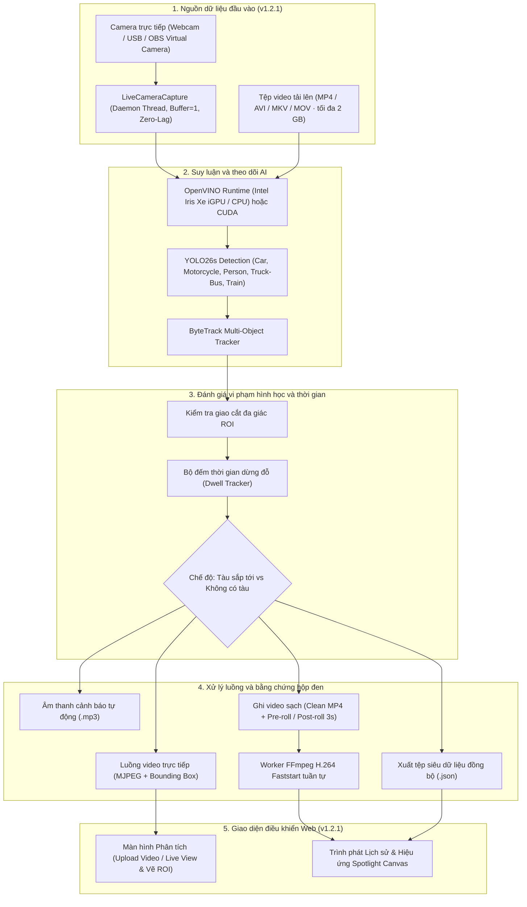

# Hệ Thống Giám Sát An Toàn Giao Thông Đường Sắt Và Cảnh Báo Xâm Phạm Thời Gian Thực

**RailSafe CV — Phiên Bản Phát Hành: v1.2.1 (Release v1.2.1)**

> Hệ thống giám sát an toàn và cảnh báo xâm phạm hành lang đường ngang đường sắt thời gian thực ứng dụng thị giác máy tính (**YOLO26s** và **ByteTrack**), tăng tốc phần cứng suy luận sâu qua **Intel OpenVINO™ iGPU / CPU** (hoặc **NVIDIA CUDA**), hỗ trợ đồng thời **Tải video kiểm thử** và **Camera trực tiếp (Webcam / USB / OBS Virtual Camera)** với cơ chế đệm chống trễ (**Zero-Latency Capture**), hộp đen ghi hình sạch và trình phát lại bằng chứng qua lớp phủ siêu dữ liệu (**Spotlight Canvas Overlay**).

---

## Mục lục
1. [Giới thiệu đề tài & Điểm mới trong v1.2.1](#1-giới-thiệu-đề-tài--điểm-mới-trong-phiên-bản-v121)
2. [Các tính năng trọng tâm](#2-các-tính-năng-trọng-tâm-của-hệ-thống)
3. [Kiến trúc hệ thống (System Pipeline)](#3-kiến-trúc-hệ-thống-system-pipeline)
4. [Cấu trúc thư mục dự án](#4-cấu-trúc-thư-mục-dự-án)
5. [Quy trình nghiên cứu thực nghiệm khoa học](#5-quy-trình-nghiên-cứu-thực-nghiệm-khoa-học)
6. [Yêu cầu hệ thống và cài đặt](#6-yêu-cầu-hệ-thống-và-cài-đặt)
7. [Hướng dẫn sử dụng và vận hành hệ thống](#7-hướng-dẫn-sử-dụng-và-vận-hành-hệ-thống)
8. [Hướng dẫn đóng gói ứng dụng (Windows)](#8-hướng-dẫn-đóng-gói-ứng-dụng-windows)
9. [Bảng tham số cấu hình và API hệ thống](#9-bảng-tham-số-cấu-hình-và-api-hệ-thống)
10. [Tác giả và bản quyền](#10-tác-giả-và-bản-quyền)

---

## 1. Giới thiệu đề tài & Điểm mới trong Phiên bản v1.2.1

### 1.1. Giới thiệu đề tài
Đường ngang giao cắt giữa đường sắt và đường bộ là một trong những điểm nóng tiềm ẩn nguy cơ tai nạn giao thông nghiêm trọng nhất trong mạng lưới đường sắt Việt Nam. Đề tài được nghiên cứu và phát triển nhằm cung cấp giải pháp giám sát tự động, thông minh, vận hành liên tục theo thời gian thực (Real-time) để hỗ trợ điều độ viên và nhân viên gác chắn đường sắt:

- **Tự động nhận diện đa đối tượng:** Nhận diện chính xác 4 lớp chướng ngại vật xâm phạm hành lang an toàn (**Người**, **Ô tô**, **Xe máy**, **Xe tải/Xe buýt**), đồng thời nhận diện **Đoàn tàu hỏa** (`train`) để kích hoạt bộ lọc loại trừ thông minh (không vẽ đè khung, không báo động sai lên tàu).
- **Cố định duy nhất kiến trúc YOLO26s:** Sử dụng duy nhất mô hình **YOLO26s** huấn luyện tối ưu trên tập dữ liệu an toàn đường sắt, mang lại độ nhạy (Recall) cao và độ chính xác tổng thể vượt trội.
- **Theo dõi quỹ đạo và đo đếm dừng đỗ (ByteTrack & Dwell Time):** Tích hợp giải thuật ByteTrack duy trì định danh (Track ID) ổn định, đếm thời gian lưu trú liên tục ngay cả khi đối tượng bị che khuất tạm thời.
- **Hai chế độ vận hành chuyên biệt:**
  - *Chế độ "Tàu sắp tới" (`train_approaching`):* Trạng thái nguy cấp, cảnh báo tức thì khi có người hoặc phương tiện bước vào vùng nguy hiểm (≥ 0.5 giây xác nhận chống nhiễu).
  - *Chế độ "Không có tàu" (`no_train`):* Giám sát chống dừng đỗ trái phép và kẹt xe trên đường ray, chỉ cảnh báo khi phương tiện dừng đỗ vượt quá thời gian cài đặt (*Dwell Time*, mặc định `5.0` giây).
- **Hệ thống âm thanh cảnh báo tự động:** Tự động phát giọng nói cảnh báo tiếng Việt tương ứng với từng chế độ (`tausaptoi.mp3` và `khongcotau.mp3`).
- **Hộp đen bằng chứng và lớp phủ Spotlight:** Ghi hình không phá hủy (Clean Video) kèm tệp siêu dữ liệu JSON đồng bộ từng khung hình, cho phép xem lại từng đối tượng vi phạm với hiệu ứng khoét sáng (Spotlight), làm tối nền xung quanh và tự động tua đến đúng khoảnh khắc xâm phạm.
- **Tăng tốc phần cứng Intel OpenVINO:** Đạt tốc độ xử lý thời gian thực **35.5 FPS** với độ trễ suy luận chỉ **28.16 ms** trên đồ họa tích hợp Intel Iris Xe Graphics của máy tính văn phòng phổ thông.

### 1.2. Những cải tiến và tính năng nổi bật trong Phiên bản v1.2.1
1. **Khắc phục triệt để lỗi hiển thị vùng ROI bị lồng 2 lần (Double ROI Bugfix):**
   - Tự động xóa sạch lớp Canvas ROI ở Frontend khi luồng `/video_feed/` đang phát, nhường quyền hiển thị duy nhất cho khung hình đã vẽ ROI chuẩn xác từ Backend Python.
   - Đảm bảo vùng đa giác ROI luôn khớp 100% trên mọi tỷ lệ khung hình camera (4:3, 16:9).
2. **Tự động nhận diện đa nguồn Camera (All-in-One Camera Detection):**
   - Quét trực tiếp thiết bị DirectShow trên Windows theo đúng thứ tự index OpenCV, nhận diện **Webcam tích hợp**, **Camera USB** và **OBS Virtual Camera** (có nhãn đánh dấu `⭐` cho OBS).
3. **Lựa chọn & chuyển đổi cổng Camera trực tiếp trong Cài đặt:**
   - Hỗ trợ chế độ *"Tự động chọn (Ưu tiên OBS Virtual Camera / Webcam)"* hoặc chọn cố định từng cổng camera qua `/get_cameras` và `/set_settings`.
   - Nút **Quét lại** cập nhật danh sách camera ngay khi vừa cắm thêm thiết bị USB mà không cần khởi động lại ứng dụng; đổi camera áp dụng tức thì khi đang phát Live View.
4. **Kiến trúc luồng đọc Camera chống trễ tích lũy (Zero-Latency Live Capture):**
   - Module `LiveCameraCapture` (`app/utils/camera_utils.py`) chạy luồng nền độc lập (Daemon Thread) có khóa đồng bộ `threading.Lock`, đặt `cv2.CAP_PROP_BUFFERSIZE = 1` để luôn đọc khung hình mới nhất và triệt tiêu độ trễ tích lũy.
5. **Bảo vệ vận hành an toàn (Single Instance & Single Tab):**
   - Khóa Mutex mức hệ điều hành (`main.py`) ngăn mở 2 cửa sổ ứng dụng đồng thời trên cùng một máy tính.
   - Khóa đơn tab trình duyệt (`tab_lock.js` dùng `BroadcastChannel` + `localStorage`) tránh xung đột camera, luồng AI và âm thanh cảnh báo.
6. **Đóng gói phát hành đồng bộ v1.2.1:**
   - Đóng gói thành tệp `.exe` độc lập qua PyInstaller (`build_release.py`, `RailwaySafety.spec`) và bộ cài đặt `Setup_RailwaySafety_v1.2.1.exe` qua Inno Setup (tích hợp sẵn Microsoft Visual C++ Redistributable).

---

## 2. Các tính năng trọng tâm của hệ thống

### 2.1. Nhận diện và bám vết đa đối tượng thời gian thực
- Sử dụng duy nhất mô hình **YOLO26s** huấn luyện trên tập dữ liệu đường sắt chuẩn 5 lớp:
  - `0: car` – **Ô tô**
  - `1: motorcycle` – **Xe máy**
  - `2: person` – **Người**
  - `3: truck-bus` – **Xe tải/Xe buýt**
  - `4: train` – **Tàu hỏa**
- **4 lớp chướng ngại vật xâm phạm:** `person`, `car`, `motorcycle`, `truck-bus` có thể bật/tắt linh hoạt trong mục **Cài đặt**.
- **Bộ lọc tàu hỏa (Train Filter):** Tàu hỏa lưu thông hợp lệ trên ray được tự động loại trừ hoàn toàn: không vẽ khung bounding box đè lên thân tàu, không kích hoạt báo động sai và tự động gỡ trạng thái nếu trước đó bị nhận nhầm khi mới tiến vào khung hình.
- **Giải thuật ByteTrack:** Liên kết hộp bao 2 giai đoạn kết hợp bộ lọc Kalman Filter, duy trì định danh bền bỉ khi phương tiện luồn lách hoặc bị che khuất tạm thời.

### 2.2. Vùng nguy hiểm đa giác tùy biến (Custom Polygon ROI)
- Vẽ trực quan đa giác vùng nguy hiểm trực tiếp trên khung hình giám sát (tối thiểu 3 đỉnh, hỗ trợ **Bỏ điểm cuối**).
- Tọa độ đỉnh được chuẩn hóa về tỷ lệ `(0.0 -> 1.0)`, tự động tương thích với mọi độ phân giải camera hoặc video.
- Kiểm tra xâm nhập kết hợp cả **giao cắt mặt nạ (mask overlap)** và **kiểm tra tâm hộp bao (`cv2.pointPolygonTest`)**.

### 2.3. Hai chế độ giám sát đường sắt chuyên biệt
- **Chế độ 1 — Tàu sắp tới (`train_approaching`):** Cảnh báo đỏ và phát âm thanh `tausaptoi.mp3` ngay khi đối tượng ở trong vùng ROI từ `0.5` giây trở lên (lọc nhiễu chớp khung hình).
- **Chế độ 2 — Không có tàu (`no_train`):** Phương tiện đi qua bình thường (chưa vượt ngưỡng *Dwell Time*) hiển thị khung vàng cam đếm giây và không bị tính là vi phạm. Chỉ khi dừng đỗ vượt quá thời gian cài đặt (mặc định `5.0` giây, tùy chỉnh từ `1` đến `60` giây), hệ thống mới phát âm thanh `khongcotau.mp3` và ghi nhận vi phạm.

### 2.4. Cơ chế hộp đen ghi hình (Pre-roll & Post-roll Ring Buffer)
- **Pre-roll Buffer 3 giây:** Bộ đệm xoay vòng liên tục lưu trữ 3 giây khung hình trước khi sự kiện vi phạm xảy ra.
- **Post-roll Recording 3 giây:** Duy trì ghi thêm 3 giây sau khi đối tượng rời khỏi vùng nguy hiểm để đoạn bằng chứng đầy đủ ngữ cảnh.
- **Bộ lọc sự kiện ngắn:** Tự động hủy sự kiện và xóa video tạm nếu tổng thời lượng vi phạm nhỏ hơn `1.0` giây.
- **Chuyển đổi H.264 bất đồng bộ:** Hàng đợi FFmpeg tuần tự (`-c:v libx264 -preset ultrafast -movflags +faststart`) giúp video phát mượt trực tiếp trên mọi trình duyệt web mà không làm nghẽn CPU.

### 2.5. Công nghệ đèn rọi Spotlight và phát lại qua siêu dữ liệu
- **Ghi hình sạch (Non-destructive Recording):** Video `.mp4` lưu trữ giữ nguyên khung hình gốc (chỉ có vùng ROI và timestamp), không vẽ cứng khung bounding box vào video.
- **Đồng bộ siêu dữ liệu JSON:** Từng khung hình lưu tọa độ hộp bao chuẩn hóa, Track ID và nhãn tiếng Việt ra tệp `.json` cùng tên.
- **Thuật toán ghép nối đa tầng (Multi-Tier Matching):** Khớp chính xác sự kiện trong nhật ký văn bản với tệp video tương ứng theo khoảng thời gian và Track ID trong metadata JSON.
- **Trình phát lại Web Canvas:**
  - Tự động tua đến trước thời điểm vi phạm 1 giây.
  - Làm tối nền ~52%, khoét sáng và vẽ viền đỏ phát sáng bao quanh đúng đối tượng vi phạm đang chọn.
  - Chuyển đổi tức thì giữa 2 chế độ: **Đánh dấu đối tượng** và **Video gốc**.
  - Hỗ trợ thanh tua timeline (`mm:ss`), nút tua nhanh `-5s` / `+5s`, điều chỉnh tốc độ (`0.5x`, `1x`, `1.5x`, `2x`), nút **Tải video** và tự động chuyển sang luồng MJPEG dự phòng (`/history_video_stream`) nếu trình duyệt không giải mã được codec video gốc.

---

## 3. Kiến trúc hệ thống (System Pipeline)



---

## 4. Cấu trúc thư mục dự án

```text
RailSafe-CV/
│
├── main.py                          # Điểm khởi chạy ứng dụng Web Flask (Single Instance Mutex)
├── run.bat                          # File batch khởi động nhanh 1-click trên Windows
├── requirements.txt                 # Danh sách thư viện phụ thuộc Python
├── .gitignore                       # Cấu hình loại trừ file tạm, cache và dữ liệu lớn
├── build_release.py                 # Script tự động hóa đóng gói phát hành (PyInstaller)
├── RailwaySafety.spec               # Kịch bản PyInstaller đóng gói tối ưu dung lượng
├── RailwaySafety_Installer.iss      # Kịch bản Inno Setup tạo bộ cài đặt Setup_RailwaySafety_v1.2.1.exe
├── ffmpeg.exe                       # Công cụ mã hóa video chuẩn web H.264
├── vc_redist.x64.exe                # Thư viện Microsoft Visual C++ Redistributable
│
├── app/                             # Mã nguồn ứng dụng (Application Package)
│   ├── __init__.py                  # Application Factory, giới hạn upload 2 GB và dọn dẹp khi tắt
│   ├── config.py                    # Quản lý cấu hình runtime (ROI, conf, dwell_time, classes, obs_cam)
│   ├── routes/                      # Tầng định tuyến API (Blueprints)
│   │   ├── __init__.py              # Đăng ký các Blueprint
│   │   ├── stream.py                # Upload/xóa video, điều khiển luồng MJPEG và trạng thái AI
│   │   ├── history.py               # API tra cứu lịch sử, xuất video MP4/MJPEG và JSON metadata
│   │   └── settings.py              # API cập nhật ROI, conf, dwell_time, classes, quét & đổi camera
│   ├── services/                    # Tầng nghiệp vụ xử lý AI và phân tích
│   │   ├── detector.py              # Nạp YOLO26s/OpenVINO, vòng lặp video/camera, ghi hộp đen
│   │   └── tracker.py               # Xử lý giao cắt đa giác ROI và đánh giá thời gian dừng đỗ
│   └── utils/                       # Module tiện ích dùng chung
│       ├── camera_utils.py          # Quét DirectShow camera (Webcam/USB/OBS) & LiveCameraCapture
│       └── video_utils.py           # Hàng đợi FFmpeg H.264 bất đồng bộ, định dạng thời gian, vẽ ROI
│
├── audio_alerts/                    # Tệp âm thanh giọng nói cảnh báo tiếng Việt
│   ├── tausaptoi.mp3                # Cảnh báo khẩn cấp khi đoàn tàu đang đến gần
│   └── khongcotau.mp3               # Cảnh báo phương tiện dừng đỗ quá thời gian
│
├── configs/                         # Cấu hình runtime của hệ thống
│   ├── detection.json               # Ngưỡng tin cậy conf, dwell_time, train_mode, obs_cam
│   ├── roi.json                     # Tọa độ các đỉnh đa giác vùng nguy hiểm ROI
│   ├── classes.json                 # Danh sách 4 lớp đối tượng giám sát vi phạm
│   └── bytetrack.yaml               # Tham số giải thuật theo dõi ByteTrack
│
├── models/                          # Trọng số mô hình AI phục vụ triển khai
│   └── yolo26s/
│       ├── model_pytorch/           # Trọng số gốc PyTorch (train-railway-yolo26s-all.pt)
│       ├── model_openvino/          # Trọng số tối ưu hóa OpenVINO FP16 (.xml và .bin)
│       └── export_openvino.py       # Script chuyển đổi mô hình PyTorch sang OpenVINO
│
├── experiments/                     # Quy trình nghiên cứu khoa học và 3 thực nghiệm đối chứng
│   ├── README.md                    # Báo cáo tổng hợp kết quả 3 thực nghiệm
│   ├── exp1_model_comparison/       # Thực nghiệm 1: So sánh YOLO11s vs YOLO26s
│   ├── exp2_tracker_comparison/     # Thực nghiệm 2: So sánh Pure YOLO vs BoT-SORT vs ByteTrack
│   └── exp3_hardware_acceleration/  # Thực nghiệm 3: Đo lường tăng tốc OpenVINO iGPU vs CPU
│
├── research/                        # Nhật ký và trọng số huấn luyện mô hình
│   └── finetune/
│       ├── train_yolo11s/           # Kết quả huấn luyện YOLO11s
│       └── train_yolo26s/           # Kết quả huấn luyện YOLO26s (mô hình được chọn)
│
├── static/                          # Tài nguyên giao diện tĩnh (CSS, JS)
│   ├── css/                         # main.css, sidebar-topbar.css, monitor.css, modal.css, history.css
│   └── js/                          # tab_lock.js, app.js, roi.js, monitor.js, history.js, settings.js
│
├── templates/                       # Giao diện web HTML (Single Page Application)
│   └── index.html
│
└── data/                            # Dữ liệu vận hành thực tế (tự tạo khi chạy)
    ├── recordings/                  # Video vi phạm sạch (.mp4) và siêu dữ liệu (.json) theo ngày
    └── intrusion_logs/              # Tệp nhật ký sự kiện văn bản (Lich_su_DD-MM-YYYY.txt)
```

---

## 5. Quy trình nghiên cứu thực nghiệm khoa học

Dự án được xây dựng theo phương pháp luận thực nghiệm chặt chẽ với 3 bài toán nghiên cứu cốt lõi tại thư mục `experiments/` (xem báo cáo chi tiết tại `experiments/README.md`):

### 5.1. Thực nghiệm 1: So sánh kiến trúc mô hình nhận diện (YOLO11s vs YOLO26s)
- **Mục tiêu:** Đánh giá chéo **YOLO11s** và **YOLO26s** trên 3 tập dữ liệu kiểm thử 5 lớp độc lập (tổng **404 ảnh / 1.238 đối tượng** gồm `roboflow_crossing`, `rcd_ground`, `rcd_elevated`).
- **Lệnh chạy:**
  ```bash
  python experiments/exp1_model_comparison/evaluate_models.py
  ```
- **Kết quả trung bình (Macro Average):**

| Mô hình | Precision | Recall | mAP@0.5 | mAP@0.5:0.95 | Latency (ms/ảnh) |
| :--- | :---: | :---: | :---: | :---: | :---: |
| **YOLO11s** (Baseline) | 80.60% | 64.42% | 70.14% | 53.21% | **82.06 ms** |
| **YOLO26s** (Đề xuất) | **81.62%** (+1.02%) | **73.39%** (+8.97%) | **80.24%** (+10.10%) | **61.87%** (+8.66%) | 102.60 ms |

- **Điểm nhấn:** **YOLO26s** vượt trội hơn YOLO11s trên cả **5/5 lớp** — nổi bật là **Người đi bộ (`person`)** đạt mAP@0.5 **`87.68%`** (`+3.99%`), **Đoàn tàu (`train`)** đạt **`81.06%`** (`+27.12%`) và **Xe tải/Xe buýt (`truck-bus`)** đạt **`70.79%`** (`+13.64%`). Do đó **YOLO26s** được chọn làm mô hình nhận diện nòng cốt duy nhất.

### 5.2. Thực nghiệm 2: Đánh giá giải thuật theo dõi đa đối tượng (MOT)
- **Mục tiêu:** So sánh `Pure YOLO`, `BoT-SORT / DeepSORT` và `ByteTrack` trên video đường ngang thực tế về độ trễ, chi phí phát sinh (Overhead) và khả năng duy trì định danh (ID).
- **Lệnh chạy:**
  ```bash
  python experiments/exp2_tracker_comparison/benchmark_tracker.py
  ```
- **Kết quả đo đạc:**

| Phương pháp | Độ trễ TB | P95 Latency | Tốc độ (FPS) | Overhead | Tuổi thọ ID TB | Hỗ trợ Dwell Time |
| :--- | :---: | :---: | :---: | :---: | :---: | :--- |
| **Pure YOLO** | 93.80 ms | 113.26 ms | 10.7 FPS | 0.00 ms | — | Không thể đo |
| **BoT-SORT / DeepSORT** | 120.90 ms | 159.97 ms | 8.3 FPS | +27.10 ms | 88.0 frames | Overhead cao |
| **ByteTrack (Đề xuất)** | **113.01 ms** | **126.55 ms** | **8.8 FPS** | **+19.21 ms** | **88.0 frames** | **Tối ưu nhất (-29.1% overhead)** |

### 5.3. Thực nghiệm 3: Tối ưu hóa suy luận và tăng tốc phần cứng
- **Mục tiêu:** Đánh giá hiệu năng suy luận khi chuyển đổi trọng số PyTorch sang **Intel OpenVINO FP16** và thực thi trên đồ họa tích hợp Intel Iris Xe Graphics.
- **Lệnh chuyển đổi và kiểm thử:**
  ```bash
  python models/yolo26s/export_openvino.py
  python experiments/exp3_hardware_acceleration/benchmark_hardware.py
  ```
- **Kết quả đo đạc (Intel Core i5-1135G7 @ 2.40GHz, Intel Iris Xe Graphics, RAM 16 GB):**

| Cấu hình Mô hình | Thiết bị | Độ trễ TB | P95 Latency | Tốc độ (FPS) | Tăng tốc | Chuẩn Real-Time (≥ 30 FPS) |
| :--- | :--- | :---: | :---: | :---: | :---: | :---: |
| **PyTorch (`.pt`)** | Intel CPU | 100.13 ms | 130.51 ms | 10.0 FPS | 1.00x (Gốc) | Chưa đạt |
| **Intel OpenVINO (`.xml`)** | Intel CPU | 249.29 ms | 330.78 ms | 4.0 FPS | 0.40x | Chưa đạt |
| **Intel OpenVINO (`.xml`)** | **Intel Iris Xe iGPU** | **28.16 ms** | **29.19 ms** | **35.5 FPS** | **3.56x** | **Đạt chuẩn Real-Time** |

---

## 6. Yêu cầu hệ thống và cài đặt

### 6.1. Yêu cầu môi trường
- **Hệ điều hành:** Windows 10 / 11 (64-bit) hoặc Linux (Ubuntu 20.04 / 22.04 LTS).
- **Phiên bản Python:** Python 3.10 hoặc 3.11.
- **Cấu hình phần cứng khuyến nghị:**
  - CPU: Intel Core i3 / i5 / i7 thế hệ 11 trở lên (khuyến nghị có đồ họa tích hợp Intel Iris Xe Graphics hoặc GPU NVIDIA CUDA).
  - RAM: Tối thiểu 8 GB (khuyến nghị 16 GB).
  - Dung lượng ổ cứng trống: Tối thiểu 5 GB.

### 6.2. Các bước cài đặt môi trường
```bash
# 1. Tạo và kích hoạt môi trường ảo (Windows)
python -m venv venv
.\venv\Scripts\activate

# 2. Cập nhật pip và cài đặt các thư viện phụ thuộc
pip install --upgrade pip
pip install -r requirements.txt
```

---

## 7. Hướng dẫn sử dụng và vận hành hệ thống

### 7.1. Bố cục giao diện điều khiển
Giao diện người dùng được thiết kế theo dạng Single Page Application gồm 3 khu vực chính:
- **Thanh điều hướng trái (Sidebar) & Thanh đầu trang (Topbar):**
  - Chuyển đổi nhanh giữa màn hình **Phân tích**, **Lịch sử** và cửa sổ **Cài đặt**.
  - Hiển thị trạng thái máy chủ và đồng hồ thời gian thực tự động phát hiện chuyển ngày lúc `00:00:00`.
- **Cột điều khiển bên trái (Control Panel):**
  - **Nguồn hình ảnh:** Chuyển đổi giữa **Tải video** (`MP4, AVI, MKV, MOV` tối đa 2 GB) và **Live View** (Camera trực tiếp).
  - **Chế độ:** Chuyển đổi giữa **Tàu sắp tới** và **Không có tàu**, kèm hộp hiển thị trạng thái cảnh báo.
  - **Vùng nguy hiểm:** Các nút **Vẽ vùng**, **Xóa**, **Lưu** và **Bỏ điểm cuối**.
- **Khu vực trung tâm & Cột phải:**
  - Khung hiển thị video trực tiếp/phân tích AI, nút hành động **Bắt đầu giám sát / Dừng giám sát** và bảng **Trạng thái & Nhật ký** cập nhật sự kiện theo thời gian thực.

### 7.2. Quy trình khởi động ứng dụng
- **Khởi động nhanh trên Windows:** Nhấp đúp tệp `run.bat` tại thư mục gốc dự án.
- **Khởi động qua Terminal / Command Prompt:**
  ```bash
  python main.py
  ```
- Hệ thống tự động dò cổng trống (ưu tiên `5000`) và mở trình duyệt tại `http://127.0.0.1:5000/`.

### 7.3. Thiết lập nguồn dữ liệu đầu vào
1. **Tải video:**
   - Chọn tab **Tải video**, kéo thả hoặc chọn tệp video giám sát (`MP4, AVI, MKV, MOV`, tối đa **2 GB**).
   - Khung hình đầu tiên sẽ hiển thị làm ảnh xem trước để vẽ vùng nguy hiểm (ROI) trước khi chạy AI.
2. **Live View (Camera trực tiếp / OBS Virtual Camera):**
   - Chọn tab **Live View**, hệ thống tự động kết nối camera đang cấu hình và hiển thị tên thiết bị (`Cổng X: Tên thiết bị`).
   - Để đổi cổng camera: mở **Cài đặt** → mục **4. Nguồn Camera Live Stream (Webcam / USB / OBS)** → nhấn **Quét lại** (nếu vừa cắm camera mới) → chọn cổng mong muốn → **Lưu cấu hình** (áp dụng ngay lập tức không cần tải lại trang).

> **Mẹo dùng OBS Virtual Camera:** Trong OBS Studio, thêm nguồn là **Media Source** hoặc **Window Capture** (tránh chọn *Display Capture* để không bị lặp màn hình), sau đó nhấn **Start Virtual Camera**.

### 7.4. Định nghĩa vùng nguy hiểm đa giác (ROI Setup)
1. Nhấn **Vẽ vùng** và chấm tối thiểu 3 điểm bao quanh phạm vi lòng ray đường ngang.
2. Nhấn **Bỏ điểm cuối** nếu muốn chỉnh lại điểm vừa chấm.
3. Nhấn **Lưu** để chuẩn hóa tọa độ `(0.0 -> 1.0)` và lưu vào `configs/roi.json`.
4. Nhấn **Xóa** nếu muốn hủy vùng ROI hiện tại.

### 7.5. Vận hành 2 chế độ giám sát an toàn
1. **Chế độ "Tàu sắp tới" (`train_approaching`):** Bất kỳ đối tượng thuộc các lớp đang bật nào đi vào vùng ROI từ `0.5` giây trở lên sẽ lập tức chuyển khung đỏ, phát âm thanh `tausaptoi.mp3` và kích hoạt hộp đen ghi hình.
2. **Chế độ "Không có tàu" (`no_train`):** Đối tượng đi qua bình thường hiển thị khung vàng cam đếm giây; chỉ khi dừng đỗ vượt quá ngưỡng *Dwell Time* (mặc định `5.0` giây), hệ thống mới báo động đỏ, phát `khongcotau.mp3` và lưu bằng chứng.

### 7.6. Tra cứu lịch sử và trình phát Spotlight
1. Chọn mục **Lịch sử** trên thanh điều hướng bên trái.
2. Chọn ngày tra cứu và lọc nhanh theo loại đối tượng (**Tất cả**, **Người**, **Ô tô**, **Xe máy**, **Xe tải/Xe buýt**).
3. Nhấn vào sự kiện để mở trình phát **Spotlight Canvas**:
   - Video tự động tua đến trước mốc vi phạm 1 giây và khoét sáng đối tượng mục tiêu.
   - Hỗ trợ chuyển đổi **Đánh dấu đối tượng** / **Video gốc**, tua nhanh `-5s` / `+5s`, chọn tốc độ `0.5x / 1x / 1.5x / 2x` và nút **Tải video** để lưu tệp `.mp4` về máy.

---

## 8. Hướng dẫn đóng gói ứng dụng (Windows)

### Bước 1: Đóng gói bằng PyInstaller
```bash
python build_release.py
```
Script tự động chạy PyInstaller theo `RailwaySafety.spec`, loại trừ các thư viện nặng không dùng đến, sao chép mô hình `models/yolo26s`, cấu hình `configs/`, âm thanh `audio_alerts/`, công cụ `ffmpeg.exe` và xuất sản phẩm ra `dist/RailwaySafety/`.

### Bước 2: Tạo bộ cài đặt hoàn chỉnh (Inno Setup)
1. Cài đặt **Inno Setup 6**.
2. Mở tệp `RailwaySafety_Installer.iss` và nhấn **Compile** (`Ctrl + F9`).
3. Bộ cài đặt `Output/Setup_RailwaySafety_v1.2.1.exe` sẽ được tạo ra, tích hợp sẵn Microsoft Visual C++ Redistributable.

---

## 9. Bảng tham số cấu hình và API hệ thống

### 9.1. Tệp cấu hình (`configs/`)

| Tệp cấu hình | Khóa tham số | Giá trị mặc định | Diễn giải chức năng |
| :--- | :--- | :--- | :--- |
| **`detection.json`** | `conf` | `0.5` | Ngưỡng tin cậy tối thiểu để chấp nhận phát hiện đối tượng. |
| | `dwell_time` | `5.0` | Thời gian dừng đỗ tối đa cho phép ở chế độ Không có tàu (giây). |
| | `train_mode` | `"train_approaching"` | Chế độ mặc định khi khởi động (`train_approaching` hoặc `no_train`). |
| | `obs_cam` | `"auto"` | Cổng camera được cấu hình (`"auto"`, `"0"`, `"1"`, ...). |
| **`classes.json`** | `classes` | `["person", "car", "motorcycle", "truck-bus"]` | Danh sách 4 lớp đối tượng được theo dõi và cảnh báo xâm phạm. |
| **`roi.json`** | `polygon` | `[{x, y}, ...]` | Tọa độ chuẩn hóa `(0.0 -> 1.0)` của đa giác vùng nguy hiểm. |
| **`bytetrack.yaml`** | `track_high_thresh` | `0.25` | Ngưỡng điểm số để ByteTrack liên kết vết ở giai đoạn 1. |
| | `track_buffer` | `30` | Số khung hình lưu giữ Track ID khi đối tượng bị che khuất. |

### 9.2. Các API Endpoints chính
- **Luồng phát & giám sát:** `GET /`, `POST /upload_video`, `POST /delete_video`, `GET /start_stream/<stream_type>`, `GET /set_ai/<stream_type>`, `GET /stop_stream/<stream_type>`, `GET /video_feed/<stream_type>`, `GET /get_data/<stream_type>`, `GET /get_events`, `GET /audio_alerts/<filename>`.
- **Cấu hình & Camera:** `GET /get_config`, `GET /get_cameras`, `POST /set_roi`, `POST /set_train_mode`, `POST /set_settings`.
- **Lịch sử & bằng chứng:** `GET /api/history/events?date=...`, `GET /history_video/<date>/<file>`, `GET /history_metadata/<date>/<file>`, `GET /history_video_stream`.

---

## 10. Tác giả và bản quyền

- **Người thực hiện:** Group 1
- **Đề tài:** Ứng dụng thị giác máy tính trong giám sát an toàn và cảnh báo xâm phạm đường ngang đường sắt.
- **Phiên bản:** `v1.2.1`
- **Kho lưu trữ mã nguồn:** [Application-of-Computer-Vision-in-Railway-Safety-Surveillance-and-Intrusion-Detection](https://github.com/LamTDHE186036/Application-of-Computer-Vision-in-Railway-Safety-Surveillance-and-Intrusion-Detection.git)
- **Mục đích:** Phục vụ học tập, nghiên cứu khoa học và phát triển ứng dụng công nghệ giao thông thông minh.
