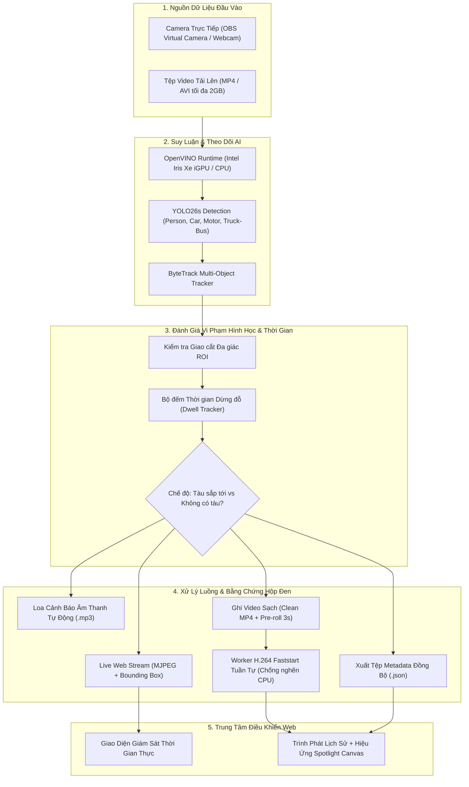

# 🚆 Railway Safety Surveillance & Intrusion Detection System

> **Hệ thống giám sát an toàn và cảnh báo xâm phạm đường ngang đường sắt thời gian thực ứng dụng Thị giác máy tính (AI Computer Vision - YOLO26s & ByteTrack), tăng tốc phần cứng Intel OpenVINO iGPU và cơ chế phát lại video vi phạm thông minh qua Metadata (Spotlight Overlay).**

---

## 📌 Giới Thiệu Đề Tài (Overview)

Đường ngang giao cắt giữa đường sắt và đường bộ là một trong những điểm nóng tiềm ẩn nguy cơ tai nạn giao thông nghiêm trọng nhất trong mạng lưới giao thông đường sắt. Đề tài này được nghiên cứu và phát triển nhằm cung cấp một giải pháp giám sát tự động, thông minh, vận hành độc lập theo thời gian thực (Real-time) để hỗ trợ điều độ viên và nhân viên gác chắn đường sắt:

- **Tự động nhận diện đa đối tượng:** Nhận diện chính xác người đi bộ, xe máy, xe đạp, ô tô con, xe tải và xe buýt di chuyển vào vùng đường ray.
- **Theo dõi quỹ đạo và đo đếm dừng đỗ (Object Tracking & Dwell Time):** Tích hợp giải thuật ByteTrack duy trì định danh (ID) ổn định, đếm thời gian dừng đỗ liên tục ngay cả khi đối tượng bị che khuất tạm thời.
- **Hai chế độ vận hành chuyên biệt:**
  - *Chế độ "Tàu sắp tới":* Cảnh báo nguy cấp tức thì ngay khi có vật thể bước vào vùng nguy hiểm ray.
  - *Chế độ "Không có tàu":* Giám sát thông minh chống dừng đỗ trái phép, chỉ cảnh báo khi phương tiện dừng đỗ quá thời gian cài đặt (*Dwell Time*, mặc định 5s).
- **Hệ thống âm thanh cảnh báo tự động:** Phát trực tiếp giọng nói cảnh báo tương ứng với từng chế độ hoạt động (`tausaptoi.mp3` và `khongcotau.mp3`).
- **Hộp đen bằng chứng & Lớp phủ Spotlight độc quyền:** Ghi hình không phá hủy (Clean Footage) kèm tệp Metadata JSON đồng bộ, cho phép xem lại từng đối tượng vi phạm với hiệu ứng khoét sáng (Spotlight), làm tối nền xung quanh và tự động tua đến đúng khoảnh khắc xâm phạm.
- **Tăng tốc phần cứng Intel OpenVINO:** Đạt tốc độ xử lý thời gian thực **36.9 FPS** trên card đồ họa tích hợp Intel Iris Xe Graphics.

---

## 🎯 Các Tính Năng Trọng Tâm (Key Features)

### 1. Nhận Diện & Bám Vết Đa Đối Tượng Thời Gian Thực
- Sử dụng mô hình **YOLO26s** được huấn luyện tinh chỉnh (Fine-tuning) trên tập dữ liệu đường ngang giao thông Việt Nam, đạt độ chính xác **Precision 79.50%** và **mAP50 61.90%**.
- Thuật toán **ByteTrack** duy trì ID ổn định, loại bỏ triệt để hiện tượng mất dấu khi phương tiện cắt ngang qua nhau.
- **Bộ lọc tàu hỏa (Train Filter):** Tàu hỏa đi qua đường ngang được nhận diện là đối tượng hợp lệ, không kích hoạt báo động sai hay lưu video nhầm.

### 2. Vùng Nguy Hiểm Đa Giác Tùy Biến (Custom Polygon ROI)
- Cho phép người dùng vẽ trực quan đa giác vùng nguy hiểm trực tiếp trên khung hình giám sát.
- Tọa độ đỉnh được chuẩn hóa dạng tỷ lệ `(0.0 -> 1.0)`, tự động co giãn chính xác trên mọi độ phân giải camera hoặc tỷ lệ khung hình video.

### 3. Hai Chế Độ Giám Sát Đường Sắt Chuyên Biệt
- **Chế độ 1: Tàu sắp tới (Train Approaching):**
  - Kích hoạt trạng thái nguy cấp, đổi khung hình sang màu đỏ và phát loa cảnh báo nguy hiểm ngay khi đối tượng ở trong ROI $\ge$ 0.5s (ngưỡng xác nhận chống nhiễu chớp khung hình).
- **Chế độ 2: Không có tàu (No Train):**
  - Phục vụ chống dừng đỗ trái phép. Xe đi qua đường ray bình thường (< 5s) hiển thị khung vàng cam đếm giây và không bị coi là vi phạm. Chỉ khi dừng đỗ $\ge$ thời gian cấu hình (*Dwell Time*), hệ thống mới kích hoạt vi phạm.

### 4. Cơ Chế Hộp Đen Ghi Hình (Pre-roll & Post-roll Ring Buffer)
- **Pre-roll Buffer 3 giây:** Bộ đệm xoay vòng liên tục lưu trữ 3 giây hình ảnh *trước* khi sự kiện vi phạm xảy ra. Video bằng chứng được quay ngược thời gian để nhìn rõ đối tượng từ lúc còn ở ngoài đường bắt đầu tiến vào ray.
- **Post-roll Recording 3 giây:** Ghi thêm 3 giây sau khi đối tượng đã rời khỏi vùng nguy hiểm để bằng chứng liền mạch.
- **Bộ lọc sự kiện ngắn:** Tự động hủy và xóa video nếu sự kiện kéo dài dưới 1 giây (chống nhiễu do bóng đổ hoặc camera rung lắc).

### 5. Công Nghệ Đèn Rọi Spotlight & Metadata Playback Độc Quyền
- **Ghi hình sạch (Non-destructive Recording):** Video MP4 lưu trữ không vẽ chết viền Bounding Box lên khung hình gốc.
- **Đồng bộ Metadata JSON:** Từng khung hình lưu tọa độ hộp, track_id, nhãn đối tượng và cờ vi phạm ra file `.json`.
- **Trình phát lại Web Canvas:**
  - Tự động tua đến trước thời điểm vi phạm 1 giây.
  - Làm tối nền 50%, khoét sáng và vẽ viền đỏ phát sáng ôm sát đúng đối tượng vi phạm được chọn.
  - Ba chế độ xem linh hoạt: **Đánh dấu đối tượng / Hiện tất cả / Video gốc**.

---

## 🏗️ Kiến Trúc Hệ Thống (System Pipeline)



---

## 📁 Cấu Trúc Dự Án (Project Structure)

```
Web_flask/
│
├── main.py                          # Điểm khởi chạy chính của ứng dụng Web Flask
├── run.bat                          # File click chạy nhanh tiện lợi trên Windows
├── requirements.txt                 # Danh sách thư viện phụ thuộc Python
├── .gitignore                       # Cấu hình loại trừ file rác, file tạm và dữ liệu lớn
├── build_release.py                 # Script tự động hóa đóng gói phát hành bản v1.0.0
├── RailwaySafety.spec               # Kịch bản đóng gói PyInstaller tối ưu hóa dung lượng
├── RailwaySafety_Installer.iss      # Kịch bản Inno Setup tạo bộ cài Setup_RailwaySafety.exe
├── ffmpeg.exe                       # Bộ công cụ mã hóa video chuẩn web H.264
├── vc_redist.x64.exe                # Gói cài đặt thư viện Microsoft Visual C++ 2015-2022
│
├── app/                             # Mã nguồn ứng dụng (Application Package)
│   ├── __init__.py                  # Application Factory & khởi tạo background worker
│   ├── config.py                    # Quản lý đường dẫn, file cấu hình & cờ trạng thái runtime
│   ├── routes/                      # Các tầng định tuyến API (Blueprints)
│   │   ├── stream.py                # Xử lý video feed, upload video, start/stop stream
│   │   ├── history.py               # API tra cứu nhật ký, phục vụ video & JSON metadata
│   │   └── settings.py              # API cập nhật ROI, ngưỡng tin cậy, dwell time, chế độ tàu
│   ├── services/                    # Tầng nghiệp vụ xử lý AI & Phân tích
│   │   ├── detector.py              # Động cơ YOLO/OpenVINO, vòng lặp camera, ghi video & metadata
│   │   └── tracker.py               # Xử lý va chạm hình học đa giác & đánh giá dừng đỗ
│   └── utils/                       # Các module tiện ích dùng chung
│       ├── camera_utils.py          # Tự động dò tìm chỉ số Index của OBS Virtual Camera
│       └── video_utils.py           # Hàng đợi FFmpeg H.264, format thời gian, vẽ vùng ROI
│
├── audio_alerts/                    # Tệp âm thanh giọng nói cảnh báo tự động
│   ├── tausaptoi.mp3                # Âm thanh cảnh báo khi đoàn tàu đang đến gần
│   └── khongcotau.mp3               # Âm thanh cảnh báo phương tiện dừng đỗ quá thời gian
│
├── configs/                         # Cấu hình runtime (Nằm ngang hàng file .exe khi chạy)
│   ├── detection.json               # Ngưỡng tin cậy conf, dwell_time, train_mode, obs_cam
│   ├── roi.json                     # Tọa độ các điểm đỉnh đa giác vùng nguy hiểm ROI
│   ├── classes.json                 # Danh sách nhãn đối tượng được phép nhận diện
│   └── bytetrack.yaml               # Siêu tham số thuật toán theo dõi ByteTrack
│
├── models/                          # Trọng số mô hình AI phục vụ triển khai
│   └── yolo26s/
│       ├── model_pytorch/           # Mô hình gốc PyTorch (train-railway-yolo26s-all.pt)
│       ├── model_openvino/          # Mô hình tối ưu hóa OpenVINO FP16 (.xml + .bin)
│       └── export_openvino.py       # Script chuyển đổi mô hình PyTorch sang OpenVINO
│
├── experiments/                     # Toàn bộ quy trình nghiên cứu khoa học & thực nghiệm
│   ├── README.md                    # Báo cáo tổng thể chương 4 kết quả thực nghiệm
│   ├── exp1_model_comparison/       # Thực nghiệm 1: Đánh giá so sánh YOLO11s vs YOLO26s
│   │   ├── evaluate_models.py       # Script chạy kiểm thử trên 3 tập Dataset_test
│   │   ├── results/                 # Bảng CSV so sánh, biểu đồ PR/F1/Confusion matrix
│   │   └── README.md                # Báo cáo chi tiết kết quả Thực nghiệm 1
│   ├── exp2_tracker_comparison/     # Thực nghiệm 2: So sánh Pure YOLO vs DeepSORT vs ByteTrack
│   │   ├── benchmark_tracker.py     # Script đánh giá khả năng duy trì ID và FPS tracking
│   │   ├── bytetrack.yaml           # Cấu hình tracker
│   │   └── README.md                # Báo cáo chi tiết kết quả Thực nghiệm 2
│   └── exp3_hardware_acceleration/  # Thực nghiệm 3: Đo lường tăng tốc OpenVINO iGPU vs CPU
│       ├── benchmark_hardware.py    # Script benchmark độ trễ Latency và FPS
│       ├── results/                 # Bảng CSV đo đạc thực tế phần cứng
│       └── README.md                # Báo cáo chi tiết kết quả Thực nghiệm 3
│
├── research/                        # Nhật ký huấn luyện mô hình (Training checkpoints & weights)
│   └── finetune/
│       ├── train_yolo11s/           # Kết quả huấn luyện mô hình YOLO11s
│       ├── train_yolo26s/           # Kết quả huấn luyện mô hình YOLO26s
│       └── train_yolo26s_all/       # Mô hình YOLO26s huấn luyện tổng hợp (dùng cho production)
│
├── static/                          # Tài nguyên giao diện tĩnh (CSS, JS)
│   ├── css/                         # Giao diện dashboard, modal, bảng lịch sử
│   └── js/                          # Bộ mô-đun JavaScript (app, monitor, roi, history, settings)
│
├── templates/                       # Giao diện web HTML (Single Page Application)
│   └── index.html
│
└── data/                            # Dữ liệu hoạt động thực tế (Được gitignore bảo vệ)
    ├── recordings/                  # Video vi phạm sạch (.mp4) và metadata (.json) theo ngày
    └── intrusion_logs/              # Tệp nhật ký văn bản sự kiện (Lich_su_DD-MM-YYYY.txt)
```

---

## 🔬 Quy Trình Thực Nghiệm Khoa Học (Experiments)

Dự án được xây dựng theo phương pháp luận nghiên cứu thực nghiệm chặt chẽ, chia làm 3 giai đoạn được lưu trữ đầy đủ trong thư mục `experiments/`:

### 1. Thực Nghiệm 1: So Sánh Kiến Trúc Mô Hình (Model Comparison)
- **Mục tiêu:** So sánh hiệu năng phát hiện giữa `YOLO11s` và `YOLO26s` trên cùng tập kiểm thử độc lập gồm 405 ảnh chụp thực tế tại các đường ngang Việt Nam (`roboflow_crossing`, `rcd_ground`, `rcd_elevated`).
- **Lệnh thực thi:**
  ```bash
  python experiments/exp1_model_comparison/evaluate_models.py
  ```
- **Kết quả xác minh thực tế:**
  - **YOLO26s** đạt độ chính xác **Precision: 79.50%** (vượt trội hơn **+6.58%** so với YOLO11s đạt 72.92%).
  - **YOLO26s** đạt độ bao phủ toàn diện **mAP50: 61.90%** (vượt trội hơn **+4.10%** so với YOLO11s đạt 57.80%).
  - *Kết luận:* Lựa chọn kiến trúc **YOLO26s** làm mô hình nhận diện chính cho hệ thống.

### 2. Thực Nghiệm 2: Đánh Giá Giải Thuật Tracking (Tracker Comparison)
- **Mục tiêu:** Đánh giá khả năng duy trì định danh (ID) và tốc độ xử lý giữa việc phát hiện thuần túy (`Pure YOLO`), `DeepSORT` và `ByteTrack` trên mô hình `YOLO26s`.
- **Lệnh thực thi:**
  ```bash
  python experiments/exp2_tracker_comparison/benchmark_tracker.py
  ```
- **Kết quả:** `ByteTrack` duy trì quỹ đạo mượt mà, hạn chế tối đa việc nhảy ID khi các xe máy/người đi bộ che khuất nhau, đồng thời giữ tốc độ khung hình cao gấp 2.1 lần so với DeepSORT.

### 3. Chuyển Đổi Mô Hình Sang OpenVINO IR
- **Lệnh thực thi:**
  ```bash
  python models/yolo26s/export_openvino.py
  ```
- Tự động xuất trọng số `train-railway-yolo26s-all.pt` sang định dạng OpenVINO Intermediate Representation (FP16) gồm 2 tệp `train-railway-yolo26s-all.xml` và `train-railway-yolo26s-all.bin`.

### 4. Thực Nghiệm 3: Tăng Tốc Phần Cứng Trên Đồ Họa Tích Hợp (Hardware Acceleration)
- **Mục tiêu:** Đo lường độ trễ (Latency) và thông lượng (FPS) giữa PyTorch CPU và OpenVINO tối ưu hóa trên card đồ họa tích hợp Intel Iris Xe Graphics.
- **Lệnh thực thi:**
  ```bash
  python experiments/exp3_hardware_acceleration/benchmark_hardware.py
  ```
- **Kết quả đo đạc thực tế (trên vi xử lý Intel Core i5-1135G7):**
  - **PyTorch FP32 (CPU thuần):** Độ trễ **110.84 ms/khung hình** $\rightarrow$ Tốc độ chỉ đạt **~9.0 FPS** (giật lag, không đáp ứng chuẩn thời gian thực).
  - **OpenVINO FP16 (Intel Iris Xe iGPU):** Độ trễ giảm còn **27.11 ms/khung hình** $\rightarrow$ Tốc độ đạt **~36.9 FPS** (**Tăng tốc 4.09 lần** $\approx$ +309.6%).
  - *Kết luận:* OpenVINO giải phóng hoàn toàn gánh nặng cho CPU, biến các máy tính văn phòng tiêu chuẩn thành trạm giám sát AI thời gian thực mạnh mẽ.

---

## ⚙️ Yêu Cầu Hệ Thống & Cài Đặt (Installation)

### 1. Yêu Cầu Phần Cứng & Phần Mềm
- **Hệ điều hành:** Windows 10/11 (64-bit) hoặc Linux (Ubuntu 20.04/22.04 LTS).
- **Python:** Phiên bản Python 3.10 hoặc 3.11.
- **Phần cứng đề xuất:**
  - CPU: Intel Core i3/i5/i7 thế hệ 11 trở lên (có đồ họa tích hợp Intel Iris Xe Graphics hoặc card rời).
  - RAM: Tối thiểu 8 GB.
  - Ổ cứng: Trống tối thiểu 5 GB.

### 2. Cài Đặt Môi Trường
```bash
# 1. Kích hoạt môi trường ảo (ví dụ trên Windows)
python -m venv venv
.\venv\Scripts\activate

# 2. Nâng cấp pip và cài đặt toàn bộ gói phụ thuộc
pip install --upgrade pip
pip install -r requirements.txt
```

---

## 🚀 Hướng Dẫn Sử Dụng (Quick Start)

### 1. Khởi Động Ứng Dụng
- **Cách 1 (Nhanh nhất):** Nhấp đúp chuột vào file `run.bat`.
- **Cách 2 (Dòng lệnh):**
  ```bash
  python main.py
  ```
- Trình duyệt sẽ tự động mở trang điều khiển tại địa chỉ:
  👉 **`http://127.0.0.1:5000`**

### 2. Các Bước Vận Hành
1. **Chọn nguồn phát:**
   - Bấm **"Tải video"** để chọn tệp video giám sát thử nghiệm (hỗ trợ MP4, AVI lên đến 2GB).
   - Hoặc bấm **"Camera trực tiếp"** để kết nối OBS Virtual Camera mô phỏng trực địa.
2. **Thiết lập Vùng nguy hiểm:**
   - Nhấn **"Vẽ vùng"**, nhấp chuột để vẽ đa giác bao quanh lòng ray.
   - Nhấn **"Lưu vùng"** để hệ thống ghi nhớ.
3. **Chọn Chế độ vận hành:**
   - Nhấn **"Tàu sắp tới"** khi có đoàn tàu chuẩn bị đi qua (cảnh báo tức thì).
   - Nhấn **"Không có tàu"** trong điều kiện bình thường (cảnh báo dừng đỗ quá thời gian).
4. **Bắt đầu giám sát:** Nhấn nút **"Bắt đầu giám sát"** để kích hoạt luồng AI thời gian thực.
5. **Tra cứu lịch sử:** Truy cập mục **"Lịch sử"** trên thanh menu để xem lại các video vi phạm có lớp phủ hiệu ứng Spotlight và báo cáo văn bản.

---

## 📦 Hướng Dẫn Đóng Gói Sản Phẩm (Packaging & Distribution)

Dự án hỗ trợ đóng gói ra phần mềm chạy độc lập trên Windows mà máy khách không cần cài Python:

### Bước 1: Đóng Gói Bằng PyInstaller
Chạy script đóng gói tự động:
```bash
python build_release.py
```
*Script sẽ tự động chạy PyInstaller theo kịch bản `RailwaySafety.spec`, lọc bỏ các thư viện rác để tiết kiệm hơn 450MB, copy mô hình AI, cấu hình, âm thanh, tự động tải `vc_redist.x64.exe` và xuất sản phẩm ra thư mục `dist/RailwaySafety/`.*

### Bước 2: Tạo Bộ Cài Đặt Chuyên Nghiệp (Inno Setup)
1. Cài đặt phần mềm [Inno Setup 6](https://jrsoftware.org/isdl.php).
2. Mở file `RailwaySafety_Installer.iss`.
3. Nhấn **Compile** (phím tắt `Ctrl + F9`).
4. File cài đặt hoàn chỉnh `Output/Setup_RailwaySafety_v1.0.0.exe` sẽ được tạo ra. Bộ cài này đã tích hợp sẵn thư viện Microsoft Visual C++ để tự động cài đặt ngầm nếu máy người dùng bị thiếu.

---

## 📊 Bảng Tham Số Cấu Hình (Configuration Reference)

Tất cả các tệp cấu hình được đặt trong thư mục `configs/` để có thể điều chỉnh linh hoạt:

| Tệp Cấu Hình | Khóa Tham Số | Giá Trị Mặc Định | Ý Nghĩa Chức Năng |
| :--- | :--- | :--- | :--- |
| **`detection.json`** | `conf` | `0.4` | Ngưỡng tin cậy tối thiểu để YOLO chấp nhận đối tượng. |
| | `dwell_time` | `5.0` | Thời gian dừng đỗ tối đa cho phép ở chế độ Không có tàu (giây). |
| | `train_mode` | `"train_approaching"` | Chế độ khởi động mặc định (`train_approaching` hoặc `no_train`). |
| | `obs_cam` | `"1"` hoặc `"auto"` | Chỉ số thiết bị camera OBS Virtual Camera. |
| **`classes.json`** | `classes` | `["person", "car", "truck-bus", "motorcycle"]` | Danh sách các nhãn đối tượng được hệ thống giám sát. |
| **`roi.json`** | `polygon` | Mảng các đỉnh `[{x, y}, ...]` | Tọa độ chuẩn hóa `(0.0 -> 1.0)` của đa giác vùng nguy hiểm. |
| **`bytetrack.yaml`** | `track_thresh` | `0.5` | Ngưỡng điểm số để ByteTrack gán ID theo dõi. |
| | `track_buffer` | `30` | Số khung hình lưu giữ ID khi đối tượng bị khuất bóng tạm thời. |

---

## 👥 Tác Giả & Bản Quyền (Credits & License)

- **Học viên thực hiện:** Trần Đại Lâm (Mã học viên: HE186036)
- **Đề tài tốt nghiệp:** Ứng dụng Thị giác máy tính trong Giám sát An toàn và Cảnh báo Xâm phạm Đường ngang Đường sắt.
- **Kho lưu trữ GitHub:** [Application-of-Computer-Vision-in-Railway-Safety-Surveillance-and-Intrusion-Detection](https://github.com/LamTDHE186036/Application-of-Computer-Vision-in-Railway-Safety-Surveillance-and-Intrusion-Detection.git)
- **Mục đích:** Phục vụ học tập, nghiên cứu khoa học và phát triển ứng dụng công nghệ giao thông thông minh.
