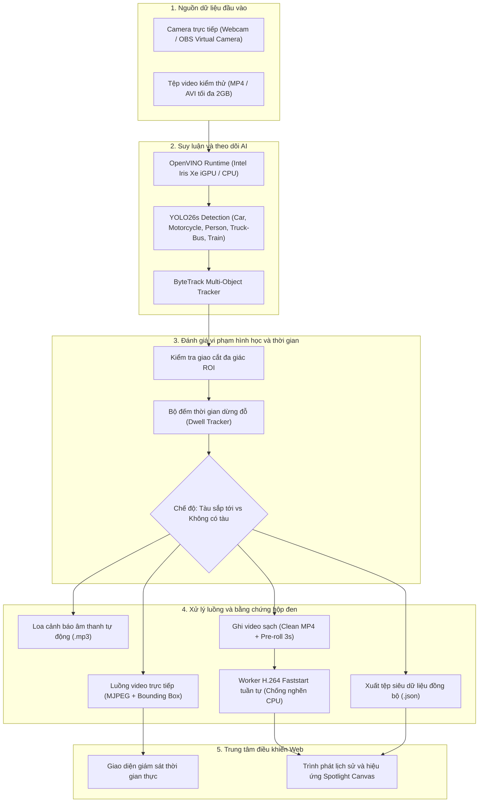

# Hệ Thống Giám Sát An Toàn Giao Thông Đường Sắt Và Cảnh Báo Xâm Phạm Thời Gian Thực

> Hệ thống giám sát an toàn và cảnh báo xâm phạm hành lang đường sắt thời gian thực ứng dụng thị giác máy tính (**YOLO26s** và **ByteTrack**), tăng tốc phần cứng suy luận sâu qua **Intel OpenVINO™ iGPU** và cơ chế phát lại video bằng chứng qua lớp phủ siêu dữ liệu (**Spotlight Canvas Overlay**).

---

## 1. Giới thiệu đề tài

Đường ngang giao cắt giữa đường sắt và đường bộ là một trong những điểm nóng tiềm ẩn nguy cơ tai nạn giao thông nghiêm trọng nhất trong mạng lưới đường sắt Việt Nam. Đề tài này được nghiên cứu và phát triển nhằm cung cấp một giải pháp giám sát tự động, thông minh, vận hành liên tục theo thời gian thực (Real-time) để hỗ trợ điều độ viên và nhân viên gác chắn đường sắt:

- **Tự động nhận diện đa đối tượng:** Nhận diện chính xác 4 lớp chướng ngại vật xâm phạm hành lang an toàn (**Người đi bộ**, **Ô tô**, **Xe máy**, **Xe tải / Xe buýt**), đồng thời nhận diện **Đoàn tàu hỏa** để kích hoạt bộ lọc thông minh loại trừ (không đánh dấu, không báo động sai lên tàu).
- **Cố định duy nhất kiến trúc YOLO26s:** Hệ thống sử dụng duy nhất mô hình **YOLO26s** huấn luyện tối ưu trên tập dữ liệu an toàn đường sắt, mang lại độ nhạy cao và khả năng nhận diện vượt trội.
- **Theo dõi quỹ đạo và đo đếm dừng đỗ (ByteTrack & Dwell Time):** Tích hợp giải thuật ByteTrack duy trì định danh (Track ID) ổn định, đếm thời gian dừng đỗ liên tục ngay cả khi đối tượng bị che khuất tạm thời.
- **Hai chế độ vận hành chuyên biệt:**
  - *Chế độ "Tàu sắp tới" (Train Approaching):* Trạng thái nguy cấp, cảnh báo tức thì khi có người hoặc phương tiện bước vào lòng ray ($\ge 0.5$ giây xác nhận chống nhiễu).
  - *Chế độ "Không có tàu" (No Train):* Giám sát thông minh chống dừng đỗ trái phép và kẹt xe, chỉ cảnh báo khi phương tiện dừng đỗ quá thời gian cài đặt (*Dwell Time*, mặc định 5.0 giây).
- **Hệ thống âm thanh cảnh báo tự động:** Tự động phát giọng nói cảnh báo tương ứng với từng chế độ hoạt động (`tausaptoi.mp3` và `khongcotau.mp3`).
- **Hộp đen bằng chứng và lớp phủ Spotlight:** Ghi hình không phá hủy (Clean Video) kèm tệp siêu dữ liệu JSON đồng bộ từng khung hình, cho phép xem lại từng đối tượng vi phạm với hiệu ứng khoét sáng (Spotlight), làm tối nền xung quanh và tự động tua đến đúng khoảnh khắc xâm phạm.
- **Tăng tốc phần cứng Intel OpenVINO:** Đạt tốc độ xử lý thời gian thực **32 – 35.8 FPS** với độ trễ suy luận chỉ **28 – 30 ms** trên đồ họa tích hợp Intel Iris Xe Graphics của máy tính văn phòng phổ thông.

---

## 2. Các tính năng trọng tâm

### 2.1. Nhận diện và bám vết đa đối tượng thời gian thực
- Sử dụng mô hình **YOLO26s** được huấn luyện hội tụ trên tập dữ liệu đường sắt chuẩn 5 lớp:
  - `0: car` – **Ô tô**
  - `1: motorcycle` – **Xe máy**
  - `2: person` – **Người đi bộ**
  - `3: truck-bus` – **Xe tải / Xe buýt**
  - `4: train` – **Tàu hỏa**
- **4 lớp chướng ngại vật xâm phạm:** `car`, `motorcycle`, `person`, `truck-bus` được đưa vào danh mục theo dõi và kích hoạt chuông cảnh báo.
- **Bộ lọc tàu hỏa (Train Filter):** Tàu hỏa lưu thông hợp lệ trên ray được hệ thống tự động nhận diện và bỏ qua hoàn toàn: **không vẽ khung bounding box đè lên thân tàu**, **không kích hoạt báo động sai**, và **không lưu video nhầm lẫn**.
- **Giải thuật ByteTrack:** Khai thác liên kết hộp bao 2 giai đoạn (kể cả các box điểm tin cậy thấp) kết hợp bộ lọc Kalman Filter, duy trì định danh bền bỉ khi phương tiện luồn lách hoặc che khuất nhau.

### 2.2. Vùng nguy hiểm đa giác tùy biến (Custom Polygon ROI)
- Cho phép người dùng vẽ trực quan đa giác vùng nguy hiểm trực tiếp trên khung hình camera giám sát.
- Tọa độ đỉnh được chuẩn hóa dạng tỷ lệ `(0.0 -> 1.0)`, tự động co giãn chính xác trên mọi độ phân giải camera hoặc tỷ lệ khung hình video.

### 2.3. Hai chế độ giám sát đường sắt chuyên biệt
- **Chế độ 1: Tàu sắp tới (Train Approaching):**
  - Kích hoạt trạng thái nguy cấp, viền khung hình chuyển đỏ và phát cảnh báo âm thanh nguy hiểm ngay khi đối tượng xâm nhập vùng ROI từ 0.5 giây trở lên (ngưỡng xác nhận chống nhiễu chớp khung hình).
- **Chế độ 2: Không có tàu (No Train):**
  - Phục vụ chống dừng đỗ trái phép trên đường ray. Phương tiện lưu thông bình thường qua đường ray (< 5.0 giây) hiển thị khung vàng cam đếm giây và không bị coi là vi phạm. Chỉ khi dừng đỗ vượt quá thời gian cấu hình (*Dwell Time*), hệ thống mới phát chuông và ghi nhận vi phạm.

### 2.4. Cơ chế hộp đen ghi hình (Pre-roll và Post-roll Ring Buffer)
- **Pre-roll Buffer 3 giây:** Bộ đệm xoay vòng liên tục lưu trữ 3 giây hình ảnh trước khi sự kiện vi phạm xảy ra. Video bằng chứng cho phép quan sát rõ đối tượng từ lúc bắt đầu tiến vào lòng ray.
- **Post-roll Recording 3 giây:** Ghi thêm 3 giây sau khi đối tượng đã rời khỏi vùng nguy hiểm để bằng chứng liền mạch.
- **Bộ lọc sự kiện ngắn:** Tự động hủy và xóa video nếu sự kiện kéo dài dưới 1 giây nhằm chống nhiễu do bóng đổ hoặc rung lắc camera.

### 2.5. Công nghệ đèn rọi Spotlight và phát lại qua siêu dữ liệu
- **Ghi hình sạch (Non-destructive Recording):** Video MP4 lưu trữ giữ nguyên khung hình gốc, không vẽ cứng viền hộp nhận diện vào video.
- **Đồng bộ siêu dữ liệu JSON:** Từng khung hình lưu tọa độ hộp bao, ID theo dõi, nhãn đối tượng và cờ vi phạm ra tệp `.json` tương ứng.
- **Trình phát lại Web Canvas:**
  - Tự động tua đến trước thời điểm vi phạm 1 giây.
  - Làm tối nền 50%, khoét sáng và vẽ viền đỏ nổi bật ôm sát đúng đối tượng vi phạm được chọn.
  - Ba chế độ hiển thị linh hoạt: Đánh dấu đối tượng vi phạm, Hiện tất cả đối tượng hoặc Xem video gốc.

---

## 3. Kiến trúc hệ thống (System Pipeline)



---

## 4. Cấu trúc thư mục dự án

```
RailwaySafety/
│
├── main.py                          # Điểm khởi chạy chính của ứng dụng Web Flask
├── run.bat                          # File batch khởi động nhanh 1-click trên Windows
├── requirements.txt                 # Danh sách thư viện phụ thuộc Python
├── .gitignore                       # Cấu hình loại trừ file tạm, cache và dữ liệu lớn
├── build_release.py                 # Script tự động hóa đóng gói phát hành (PyInstaller)
├── RailwaySafety.spec               # Kịch bản PyInstaller đóng gói tối ưu dung lượng
├── RailwaySafety_Installer.iss      # Kịch bản Inno Setup tạo bộ cài đặt Setup_RailwaySafety.exe
├── ffmpeg.exe                       # Công cụ mã hóa video chuẩn web H.264
├── vc_redist.x64.exe                # Thư viện Microsoft Visual C++ Redistributable
│
├── app/                             # Mã nguồn ứng dụng (Application Package)
│   ├── __init__.py                  # Application Factory và khởi tạo background worker
│   ├── config.py                    # Quản lý cấu hình runtime, ngưỡng tin cậy và ROI
│   ├── routes/                      # Tầng định tuyến API (Blueprints)
│   │   ├── stream.py                # Xử lý luồng video MJPEG, tải video, điều khiển phát
│   │   ├── history.py               # API tra cứu lịch sử, xuất video và JSON metadata
│   │   └── settings.py              # API cập nhật ROI, ngưỡng conf, dwell time, chế độ tàu
│   ├── services/                    # Tầng nghiệp vụ xử lý AI và phân tích
│   │   ├── detector.py              # Bộ phát hiện YOLO26s / OpenVINO, vòng lặp camera, ghi video
│   │   └── tracker.py               # Xử lý giao cắt đa giác và đánh giá thời gian dừng đỗ
│   └── utils/                       # Module tiện ích dùng chung
│       ├── camera_utils.py          # Tự động nhận diện thiết bị camera (OBS, Webcam)
│       └── video_utils.py           # Hàng đợi FFmpeg H.264 bất đồng bộ, vẽ vùng ROI
│
├── audio_alerts/                    # Tệp âm thanh giọng nói cảnh báo tự động tiếng Việt
│   ├── tausaptoi.mp3                # Cảnh báo khẩn cấp khi đoàn tàu đang đến gần
│   └── khongcotau.mp3               # Cảnh báo phương tiện dừng đỗ quá thời gian
│
├── configs/                         # Cấu hình runtime của hệ thống
│   ├── detection.json               # Ngưỡng tin cậy conf, dwell_time, train_mode, obs_cam
│   ├── roi.json                     # Tọa độ các đỉnh đa giác vùng nguy hiểm ROI
│   ├── classes.json                 # Danh sách 4 lớp đối tượng giám sát vi phạm
│   └── bytetrack.yaml               # Tham số giải thuật theo dõi ByteTrack
│
├── models/                          # Trọng số mô hình AI phục vụ triển khai
│   └── yolo26s/
│       ├── model_pytorch/           # Trọng số gốc PyTorch (train-railway-yolo26s-all.pt)
│       ├── model_openvino/          # Trọng số tối ưu hóa OpenVINO FP16 (.xml và .bin)
│       └── export_openvino.py       # Script chuyển đổi mô hình PyTorch sang OpenVINO
│
├── experiments/                     # Toàn bộ quy trình nghiên cứu khoa học và thực nghiệm
│   ├── README.md                    # Báo cáo tổng thể kết quả 3 thực nghiệm
│   ├── exp1_model_comparison/       # Thực nghiệm 1: So sánh mô hình YOLO11s vs YOLO26s
│   │   ├── evaluate_models.py       # Script kiểm thử trên 3 tập Dataset_test
│   │   ├── results/                 # Bảng CSV số liệu và biểu đồ PR/F1/Confusion matrix
│   │   └── README.md                # Báo cáo chi tiết Thực nghiệm 1
│   ├── exp2_tracker_comparison/     # Thực nghiệm 2: So sánh Pure YOLO vs BoT-SORT vs ByteTrack
│   │   ├── benchmark_tracker.py     # Script đo lường FPS, độ trễ và khả năng duy trì ID
│   │   ├── bytetrack.yaml           # Cấu hình tracker
│   │   └── README.md                # Báo cáo chi tiết Thực nghiệm 2
│   └── exp3_hardware_acceleration/  # Thực nghiệm 3: Đo lường tăng tốc OpenVINO iGPU vs CPU
│       ├── benchmark_hardware.py    # Script benchmark độ trễ suy luận và FPS
│       ├── results/                 # Bảng CSV số liệu đo đạc thực tế
│       └── README.md                # Báo cáo chi tiết Thực nghiệm 3
│
├── research/                        # Nhật ký và trọng số huấn luyện mô hình
│   └── finetune/
│       ├── train_yolo11s_all/       # Quá trình huấn luyện mô hình YOLO11s
│       └── train_yolo26s_all/       # Quá trình huấn luyện mô hình YOLO26s (mô hình chọn)
│
├── static/                          # Tài nguyên giao diện tĩnh (CSS, JS)
│   ├── css/                         # Định kiểu dashboard, modal, bảng lịch sử
│   └── js/                          # Bộ mô-đun JavaScript (app, history, settings)
│
├── templates/                       # Giao diện web HTML (Single Page Application)
│   └── index.html
│
└── data/                            # Dữ liệu vận hành thực tế
    ├── recordings/                  # Video vi phạm sạch (.mp4) và siêu dữ liệu (.json) theo ngày
    └── intrusion_logs/              # Tệp nhật ký sự kiện văn bản (Lich_su_DD-MM-YYYY.txt)
```

---

## 5. Quy trình nghiên cứu thực nghiệm khoa học

Dự án được xây dựng theo phương pháp luận nghiên cứu thực nghiệm chặt chẽ, bao gồm 3 bài toán nghiên cứu cốt lõi được lưu trữ tại thư mục `experiments/`:

### 5.1. Thực nghiệm 1: So sánh kiến trúc mô hình nhận diện (YOLO11s vs YOLO26s)
- **Mục tiêu:** So sánh đối đầu giữa kiến trúc cơ sở **YOLO11s** và kiến trúc đề xuất **YOLO26s** trên 3 tập dữ liệu kiểm thử thực tế độc lập thuộc thư mục `Dataset_test/` (tổng số 405 ảnh gồm `roboflow_crossing`, `rcd_ground`, `rcd_elevated`).
- **Thực thi kiểm thử:**
  ```bash
  python experiments/exp1_model_comparison/evaluate_models.py
  ```
- **Kết quả so sánh trung bình (Macro Average):**
  - **YOLO11s (Baseline):** Precision 87.31%, Recall 65.03%, mAP@0.5 73.24%, mAP@0.5:0.95 47.29%, Latency 64.80 ms.
  - **YOLO26s (Đề xuất):** Precision 84.55%, Recall **66.97%** (+1.94%), mAP@0.5 **75.18%** (+1.94%), mAP@0.5:0.95 **48.82%** (+1.53%), Latency 65.53 ms.
  - **Phân lớp Người đi bộ (`person`):** YOLO26s đạt mAP@0.5 **80.68%** so với 75.23% của YOLO11s (**tăng vọt +5.45%**).
- **Kết luận:** YOLO26s áp đảo về độ nhạy (Recall) và độ chính xác tổng thể, đặc biệt với người đi bộ qua đường ray. Do đó, **YOLO26s được quyết định lựa chọn làm mô hình nhận diện nòng cốt duy nhất** cho toàn bộ hệ thống.

### 5.2. Thực nghiệm 2: Đánh giá giải thuật theo dõi đa đối tượng (Multi-Object Tracking)
- **Mục tiêu:** Đo đạc độ trễ suy luận, chi phí tính toán phát sinh (Overhead) và khả năng duy trì định danh (ID) giữa nhận diện thuần túy (`Pure YOLO`), `BoT-SORT / DeepSORT` và `ByteTrack` trên chuỗi video đường ngang thực tế `Dataset_test/test_exp.mp4`.
- **Thực thi:**
  ```bash
  python experiments/exp2_tracker_comparison/benchmark_tracker.py
  ```
- **Kết quả đo đạc thực tế:**
  - **Pure YOLO (Không tracking):** Latency 93.80 ms (10.7 FPS), Overhead 0.00 ms, hoàn toàn không có ID nên không thể đo thời gian dừng đỗ (Dwell Time).
  - **BoT-SORT / DeepSORT:** Latency 120.90 ms (8.3 FPS), Overhead phát sinh **+27.10 ms**, tốn tài nguyên Re-ID ngoại hình.
  - **ByteTrack (Đề xuất):** Latency **113.01 ms** (8.8 FPS), Overhead chỉ **+19.21 ms** (tiết kiệm **29.1%** chi phí tính toán so với BoT-SORT), duy trì định danh ổn định (vòng đời trung bình 88.0 frames/ID).
- **Kết luận:** ByteTrack được lựa chọn chính thức làm giải thuật tracking của hệ thống.

### 5.3. Thực nghiệm 3: Tối ưu hóa suy luận và tăng tốc phần cứng
- **Mục tiêu:** Đánh giá mức độ cải thiện tốc độ và độ trễ khi chuyển đổi mô hình PyTorch sang định dạng OpenVINO FP16 và thực thi trên đồ họa tích hợp Intel Iris Xe Graphics.
- **Thực thi chuyển đổi và kiểm thử:**
  ```bash
  python models/yolo26s/export_openvino.py
  python experiments/exp3_hardware_acceleration/benchmark_hardware.py
  ```
- **Kết quả đo đạc thực tế (trên vi xử lý Intel Core i5-1135G7 @ 2.40GHz):**
  - **PyTorch CPU thuần (`.pt`):** Độ trễ **100 – 129 ms** $\rightarrow$ Tốc độ chỉ đạt **7.7 – 10.0 FPS** (không đạt chuẩn thời gian thực $\ge 30$ FPS).
  - **Intel OpenVINO trên CPU (`.xml`):** Tối ưu hóa tập lệnh AVX-512 và Layer Fusion.
  - **Intel OpenVINO trên Intel Iris Xe iGPU (`.xml`):** Độ trễ giảm sâu xuống **28 – 30.9 ms** $\rightarrow$ Tốc độ đạt **32.3 – 35.8 FPS** (tăng tốc **3.5 – 4.18 lần** so với PyTorch CPU).
- **Ý nghĩa:** OpenVINO đưa toàn bộ pipeline AI đạt chuẩn thời gian thực ($\ge 30$ FPS) ngay trên các dòng máy tính văn phòng phổ thông (\$400 – \$600), tiết kiệm chi phí đầu tư card đồ họa rời đắt tiền cho các chốt chắn đường sắt.

---

## 6. Yêu cầu hệ thống và cài đặt

### 6.1. Yêu cầu môi trường
- **Hệ điều hành:** Windows 10 / 11 (64-bit) hoặc Linux (Ubuntu 20.04 / 22.04 LTS).
- **Phiên bản Python:** Python 3.10 hoặc 3.11.
- **Cấu hình phần cứng khuyến nghị:**
  - CPU: Intel Core i3 / i5 / i7 thế hệ 11 trở lên (khuyến nghị có đồ họa tích hợp Intel Iris Xe Graphics hoặc card đồ họa rời NVIDIA).
  - Bộ nhớ RAM: Tối thiểu 8 GB (khuyến nghị 16 GB).
  - Dung lượng ổ cứng: Trống tối thiểu 5 GB.

### 6.2. Các bước cài đặt môi trường
```bash
# 1. Tạo và kích hoạt môi trường ảo (trên Windows)
python -m venv venv
.\venv\Scripts\activate

# 2. Cập nhật pip và cài đặt các thư viện phụ thuộc
pip install --upgrade pip
pip install -r requirements.txt
```

---

## 7. Hướng dẫn sử dụng và vận hành hệ thống

### 7.1. Bố cục giao diện điều khiển (Dashboard Layout)
Giao diện người dùng được thiết kế trực quan theo dạng Single Page Application:
- **Thanh điều hướng trên cùng (Header):**
  - Hiển thị tiêu đề hệ thống, đồng hồ thời gian thực và đèn chỉ báo trạng thái máy chủ.
  - Nút chuyển đổi nhanh giữa tab "Giám sát thời gian thực" và tab "Lịch sử vi phạm".
  - Nút mở cửa sổ "Cài đặt" cấu hình các thông số vận hành.
- **Khu vực hiển thị luồng video trung tâm (Center Video Player):**
  - Khung phát video trực tiếp kèm khung nhận diện đối tượng (Bounding Box), định danh đối tượng (Track ID), nhãn phân loại tiếng Việt và thời gian dừng đỗ (Dwell Time).
  - Lớp vẽ đồ họa tương tác cho phép người dùng nhấp chuột vẽ đa giác vùng nguy hiểm (ROI Polygon).
  - Đèn chỉ báo vi phạm đổi màu viền khung hình (Xanh lá: An toàn, Đỏ: Cảnh báo vi phạm xâm nhập).
- **Cột điều khiển nghiệp vụ bên trái (Left Control Panel):**
  - Nhóm chọn nguồn dữ liệu đầu vào: Nút "Tải video" và nút "Camera trực tiếp".
  - Nhóm chọn chế độ giám sát: Nút chuyển đổi giữa "Tàu sắp tới" (Train Approaching) và "Không có tàu" (No Train).
  - Nhóm nút thao tác luồng: "Bắt đầu giám sát", "Dừng giám sát", "Tải lại".
  - Nhóm nút thao tác vùng ROI: "Vẽ vùng nguy hiểm", "Lưu vùng", "Xóa vùng".
- **Thanh thẻ thông số trạng thái thời gian thực (Status Cards):**
  - Thiết bị phần cứng và công nghệ suy luận (Intel OpenVINO FP16).
  - Tốc độ xử lý khung hình hiện tại (FPS).
  - Tổng số đối tượng đang được theo dõi trong khung hình.
  - Số lượng đối tượng đang nằm trong vùng nguy hiểm.

### 7.2. Quy trình khởi động ứng dụng
1. **Khởi động nhanh trên môi trường Windows:**
   - Nhấp đúp chuột vào tệp `run.bat` tại thư mục gốc của dự án.
   - Script tự động kiểm tra môi trường Python, kích hoạt môi trường ảo và khởi chạy máy chủ Flask.
2. **Khởi động bằng dòng lệnh Terminal hoặc Command Prompt:**
   ```bash
   python main.py
   ```
3. **Truy cập giao diện hệ thống:**
   - Trình duyệt web mặc định sẽ tự động mở trang điều khiển tại địa chỉ: `http://127.0.0.1:5000`.

### 7.3. Hướng dẫn thiết lập nguồn dữ liệu đầu vào
1. **Sử dụng tệp video kiểm thử (Tải video):**
   - Nhấp vào nút "Tải video" trên bảng điều khiển bên trái.
   - Chọn tệp video giám sát có sẵn (hỗ trợ `.mp4`, `.avi`, dung lượng tối đa 2GB). Người dùng có thể sử dụng video kiểm thử mẫu tại `Dataset_test/test_exp.mp4`.
   - Video được nạp lên hệ thống và hiển thị khung hình đầu tiên sẵn sàng cho quá trình xử lý.
2. **Kết nối Camera trực tiếp (OBS Virtual Camera hoặc Webcam):**
   - Nếu sử dụng phần mềm OBS Studio để mô phỏng camera giám sát tuyến đường sắt, mở OBS và nhấp chọn "Start Virtual Camera".
   - Trên giao diện web, nhấp vào nút "Camera trực tiếp". Hệ thống tự động nhận diện thiết bị camera OBS và phát luồng trực tiếp.

### 7.4. Hướng dẫn định nghĩa vùng nguy hiểm đa giác (ROI Setup)
1. Nhấn vào nút **"Vẽ vùng"** trên thanh công cụ bên trái. Con trỏ chuột chuyển thành hình chữ thập.
2. Nhấp chuột trái lần lượt vào các góc bao quanh phạm vi lòng ray đường ngang để tạo thành đa giác khép kín (tối thiểu từ 3 đến 8 đỉnh).
3. Nhấn nút **"Lưu vùng"** để hoàn tất. Hệ thống tự động chuẩn hóa tọa độ các đỉnh về dạng tỷ lệ `(0.0 -> 1.0)` và ghi vào tệp `configs/roi.json`.
4. Nhấn **"Xóa vùng"** nếu muốn xóa bỏ đa giác hiện tại và thiết lập lại từ đầu.

### 7.5. Hướng dẫn vận hành 2 chế độ giám sát an toàn
1. **Vận hành Chế độ "Tàu sắp tới" (Train Approaching Mode):**
   - **Mục đích:** Sử dụng khi nhận được tín hiệu báo đoàn tàu đang chuẩn bị đi qua đường ngang, cần sơ tán tuyệt đối lòng ray.
   - **Thao tác:** Nhấp vào nút "Tàu sắp tới" (viền đỏ cảnh báo).
   - **Hành vi hệ thống:**
     - Bất kỳ người đi bộ hoặc phương tiện nào đi vào bên trong vùng đa giác ROI từ 0.5 giây trở lên lập tức bị phân loại là vi phạm xâm nhập nguy cấp.
     - Khung viền nhận diện chuyển sang màu đỏ rực, viền toàn khung hình chớp đỏ.
     - Hệ thống phát ngay lập tức âm thanh cảnh báo nguy cấp `audio_alerts/tausaptoi.mp3` qua loa trạm.
     - Kích hoạt trình ghi hình hộp đen lưu video vi phạm và siêu dữ liệu đồng bộ.
2. **Vận hành Chế độ "Không có tàu" (No Train Mode):**
   - **Mục đích:** Sử dụng trong điều kiện giao thông bình thường khi chưa có tàu đến, giám sát chống dừng đỗ trái phép và kẹt xe trong lòng ray.
   - **Thao tác:** Nhấp vào nút "Không có tàu" (viền vàng cam).
   - **Hành vi hệ thống:**
     - Người và phương tiện lưu thông qua lại bình thường (< 5.0 giây mặc định) được hiển thị khung vàng cam đếm giây lưu trú và không bị tính là vi phạm.
     - Nếu một phương tiện bị chết máy hoặc cố tình dừng đỗ trong lòng ray vượt quá thời gian cho phép (Dwell Time $\ge$ 5.0 giây), hệ thống lập tức chuyển sang trạng thái vi phạm, phát âm thanh nhắc nhở `audio_alerts/khongcotau.mp3` và lưu trữ video bằng chứng.

### 7.6. Hướng dẫn tra cứu lịch sử và sử dụng trình phát Spotlight
Khi có sự kiện vi phạm xảy ra, hệ thống tự động ghi lại video bằng chứng sạch (Pre-roll 3 giây trước sự kiện và Post-roll 3 giây sau sự kiện) kèm tệp siêu dữ liệu `.json` đồng bộ:
1. Nhấp vào nút **"Lịch sử"** trên thanh điều hướng đầu trang.
2. Chọn ngày cần tra cứu trên thanh công cụ lọc lịch sử (mặc định hiển thị ngày hiện tại).
3. Sử dụng các nút lọc phân loại nhanh: **Tất cả**, **Người**, **Ô tô**, **Xe máy**, **Xe tải / Xe buýt**.
4. Nhấp vào nút **"Xem video"** của bản ghi tương ứng để mở trình phát lại Spotlight Canvas:
   - Trình phát tự động tua đến trước thời điểm vi phạm 1 giây.
   - Toàn bộ khung nền xung quanh được làm tối 50%, đồng thời khu vực đối tượng vi phạm được khoét sáng nổi bật kèm khung viền phát sáng màu đỏ ôm sát đối tượng trong từng chuyển động.
   - Ba chế độ xem: *Đánh dấu đối tượng vi phạm*, *Hiện tất cả đối tượng*, *Xem video gốc*.
5. Người dùng có thể nhấp vào nút "Tải video" để tải tệp MP4 hoặc "Tải nhật ký" để tải tệp văn bản nhật ký vi phạm về máy tính.

---

## 8. Hướng dẫn đóng gói ứng dụng (Packaging)

Hệ thống hỗ trợ đóng gói thành tệp thực thi độc lập trên Windows mà máy trạm không cần cài đặt sẵn Python:

### Bước 1: Đóng gói bằng PyInstaller
Thực thi script đóng gói tự động:
```bash
python build_release.py
```
Script sẽ tự động chạy PyInstaller theo kịch bản `RailwaySafety.spec`, lọc bỏ các thư viện dư thừa để giảm dung lượng, sao chép cấu hình, trọng số mô hình OpenVINO `models/yolo26s/model_openvino`, tệp âm thanh cảnh báo và xuất sản phẩm ra thư mục `dist/RailwaySafety/`.

### Bước 2: Tạo bộ cài đặt hoàn chỉnh (Inno Setup)
1. Cài đặt phần mềm Inno Setup 6.
2. Mở tệp kịch bản `RailwaySafety_Installer.iss`.
3. Nhấn nút **Compile** (phím tắt `Ctrl + F9`).
4. Tệp cài đặt hoàn chỉnh `Output/Setup_RailwaySafety_v1.1.0.exe` sẽ được tạo ra, đã tích hợp sẵn thư viện Microsoft Visual C++ Redistributable để tự động cài đặt bổ sung nếu hệ thống thiếu hụt.

---

## 9. Bảng tham số cấu hình hệ thống

Các tệp cấu hình được đặt trong thư mục `configs/` phục vụ việc điều chỉnh linh hoạt không cần sửa mã nguồn:

| Tệp cấu hình | Khóa tham số | Giá trị mặc định | Diễn giải chức năng |
| :--- | :--- | :--- | :--- |
| **`detection.json`** | `conf` | `0.4` | Ngưỡng tin cậy tối thiểu để mô hình chấp nhận phát hiện. |
| | `dwell_time` | `5.0` | Thời gian dừng đỗ tối đa cho phép ở chế độ Không có tàu (giây). |
| | `train_mode` | `"train_approaching"` | Chế độ mặc định khi khởi động hệ thống (`train_approaching` hoặc `no_train`). |
| | `obs_cam` | `"0"` hoặc `"auto"` | Chỉ số định danh thiết bị camera được kết nối. |
| **`classes.json`** | `classes` | `["person", "car", "motorcycle", "truck-bus"]` | Danh sách 4 lớp đối tượng chướng ngại vật được hệ thống theo dõi và phát hiện xâm phạm. |
| **`roi.json`** | `polygon` | Mảng tọa độ đỉnh `[{x, y}, ...]` | Tọa độ chuẩn hóa `(0.0 -> 1.0)` của đa giác vùng nguy hiểm. |
| **`bytetrack.yaml`** | `track_high_thresh` | `0.25` | Ngưỡng điểm số để ByteTrack liên kết vết theo dõi ở giai đoạn 1. |
| | `track_buffer` | `30` | Số lượng khung hình lưu giữ ID khi đối tượng bị che khuất. |

---

## 10. Tác giả và bản quyền

- **Người thực hiện:** Group 1 
- **Đề tài:** Ứng dụng thị giác máy tính trong giám sát an toàn và cảnh báo xâm phạm đường ngang đường sắt.
- **Kho lưu trữ mã nguồn:** [Application-of-Computer-Vision-in-Railway-Safety-Surveillance-and-Intrusion-Detection](https://github.com/LamTDHE186036/Application-of-Computer-Vision-in-Railway-Safety-Surveillance-and-Intrusion-Detection.git)
- **Mục đích:** Phục vụ học tập, nghiên cứu khoa học và phát triển ứng dụng công nghệ giao thông thông minh.
