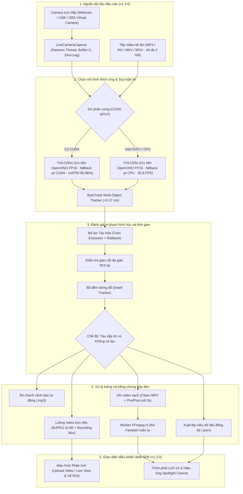

# Hệ Thống Giám Sát An Toàn Giao Thông Đường Sắt Và Cảnh Báo Xâm Phạm Thời Gian Thực

**RailSafe CV — Phiên Bản Phát Hành: v1.3.0 (Release v1.3.0)**

> Hệ thống giám sát an toàn và cảnh báo xâm phạm hành lang đường ngang đường sắt thời gian thực ứng dụng thị giác máy tính với cơ chế **chọn mô hình thích ứng phần cứng (Adaptive Hardware-Aware Selection: `YOLO26m` cho NVIDIA CUDA GPU / `YOLO26s` OpenVINO FP16 cho Intel Iris Xe iGPU & CPU)** kết hợp **ByteTrack**, hỗ trợ đồng thời **Tải video kiểm thử** và **Camera trực tiếp (Webcam / USB / OBS Virtual Camera)** với cơ chế đệm chống trễ (**Zero-Latency Capture**), hộp đen ghi hình sạch và trình phát lại bằng chứng qua lớp phủ siêu dữ liệu (**Spotlight Canvas Overlay**).

---

## Mục lục
1. [Giới thiệu đề tài & Điểm mới trong v1.3.0](#1-giới-thiệu-đề-tài--điểm-mới-trong-phiên-bản-v130)
2. [Các tính năng trọng tâm](#2-các-tính-năng-trọng-tâm-của-hệ-thống)
3. [Kiến trúc hệ thống (System Pipeline)](#3-kiến-trúc-hệ-thống-system-pipeline)
4. [Cấu trúc thư mục dự án](#4-cấu-trúc-thư-mục-dự-án)
5. [Quy trình nghiên cứu thực nghiệm khoa học](#5-quy-trình-nghiên-cứu-thực-nghiệm-khoa-học)
6. [Yêu cầu hệ thống và cài đặt](#6-yêu-cầu-hệ-thống-và-cài-đặt)
7. [Hướng dẫn sử dụng và vận hành hệ thống](#7-hướng-dẫn-sử-dụng-và-vận-hành-hệ-thống)
8. [Hướng dẫn đóng gói ứng dụng (Windows)](#8-hướng-dẫn-đóng-gói-ứng-dụng-windows)
9. [Bảng tham số cấu hình và API hệ thống](#9-bảng-tham-số-cấu-hình-và-api-hệ-thống)
10. [Tác giả và bản quyền](#10-tác-giả-và-bản-quyền)

---

## 1. Giới thiệu đề tài & Điểm mới trong Phiên bản v1.3.0

### 1.1. Giới thiệu đề tài
Đường ngang giao cắt giữa đường sắt và đường bộ là một trong những điểm nóng tiềm ẩn nguy cơ tai nạn giao thông nghiêm trọng nhất trong mạng lưới đường sắt Việt Nam. Đề tài được nghiên cứu và phát triển nhằm cung cấp giải pháp giám sát tự động, thông minh, vận hành liên tục theo thời gian thực (Real-time) để hỗ trợ điều độ viên và nhân viên gác chắn đường sắt:

- **Tự động nhận diện đa đối tượng (5 lớp đường sắt):** Nhận diện chính xác 4 lớp chướng ngại vật xâm phạm hành lang an toàn (**Người**, **Ô tô**, **Xe máy**, **Xe tải/Xe buýt**), đồng thời nhận diện **Đoàn tàu hỏa** (`train`) để kích hoạt bộ lọc loại trừ thông minh (không vẽ đè khung, không báo động sai lên tàu và tự động thu hồi trạng thái nếu đầu tàu bị nhận nhầm tạm thời).
- **Chọn mô hình thích ứng phần cứng (`YOLO26m` + `YOLO26s` — Ưu tiên OpenVINO, dự phòng `.pt`):**
  - Tự động chọn **`YOLO26m`** trên máy có GPU rời NVIDIA (ưu tiên **OpenVINO FP16**, tự động fallback sang `.pt` nếu OpenVINO lỗi) để đạt độ chính xác tối đa (**`85.96%` mAP@0.5**, **`72.47%` mAP@0.5:0.95**).
  - Tự động chọn **`YOLO26s`** trên máy không có GPU rời (ưu tiên **OpenVINO FP16** trên Intel Iris Xe iGPU/CPU, tự động fallback sang `.pt` nếu OpenVINO lỗi) để đạt tốc độ **Real-Time `30.8 FPS` (`32.51 ms`)**.
- **Theo dõi quỹ đạo và đo đếm dừng đỗ (ByteTrack & Dwell Time):** Tích hợp giải thuật ByteTrack siêu nhẹ (`+0.27 ms` overhead trên `YOLO26s`), duy trì định danh (Track ID) bền bỉ khi đối tượng bị che khuất tạm thời.
- **Hai chế độ vận hành chuyên biệt:**
  - *Chế độ "Tàu sắp tới" (`train_approaching`):* Trạng thái nguy cấp, cảnh báo tức thì khi có người hoặc phương tiện bước vào vùng nguy hiểm ($\ge 0.5$ giây xác nhận chống nhiễu).
  - *Chế độ "Không có tàu" (`no_train`):* Giám sát chống dừng đỗ trái phép và kẹt xe trên đường ray, chỉ cảnh báo khi phương tiện dừng đỗ vượt quá thời gian cài đặt (*Dwell Time*, mặc định `5.0` giây, tùy chỉnh `1–60` giây).
- **Hệ thống âm thanh cảnh báo tự động:** Tự động phát giọng nói cảnh báo tiếng Việt tương ứng với từng chế độ (`tausaptoi.mp3` và `khongcotau.mp3`).
- **Hộp đen bằng chứng và lớp phủ Spotlight:** Ghi hình không phá hủy (Clean Video) kèm tệp siêu dữ liệu JSON đồng bộ từng khung hình, cho phép xem lại từng đối tượng vi phạm với hiệu ứng khoét sáng (Spotlight), làm tối nền xung quanh và tự động tua đến đúng khoảnh khắc xâm phạm.

### 1.2. Những cải tiến nổi bật trong Phiên bản v1.3.0
1. **Cơ chế Chọn Mô hình Thích ứng Phần cứng (Adaptive Hardware-Aware Model Selection):**
   - Nâng cấp `app/services/detector.py` tự động dò GPU rời NVIDIA CUDA để kích hoạt **`YOLO26m`** (`models/yolo26m/`), và tự động dùng **`YOLO26s` OpenVINO FP16** (`models/yolo26s/`) trên máy Intel iGPU/CPU — cân bằng tối ưu giữa độ chính xác và tốc độ Real-Time trên mọi cấu hình triển khai.
2. **Bổ sung mô hình `YOLO26m` chuẩn PyTorch & Intel OpenVINO FP16:**
   - Hoàn thiện bộ công cụ `models/yolo26m/export_openvino.py` và lưu trữ sẵn trọng số OpenVINO FP16 tại `models/yolo26m/model_openvino/`.
3. **Chuẩn hóa toàn bộ 3 Thực nghiệm Khoa học cho cả `YOLO11s`, `YOLO26s` và `YOLO26m`:**
   - **Thực nghiệm 1:** Gộp đánh giá đối đầu **3 mô hình** (`YOLO11s` vs `YOLO26s` vs `YOLO26m`) trên 404 ảnh kiểm thử độc lập kèm 3 biểu đồ trực quan.
   - **Thực nghiệm 2 & 3:** Nâng cấp đánh giá Tracking MOT và Tăng tốc Phần cứng đồng thời cho **cả `YOLO26s` lẫn `YOLO26m`**, sửa lỗi giữ nguyên warmup trên cùng instance mô hình để đo chính xác Tracking Overhead.
4. **Kế thừa trọn vẹn các tối ưu cốt lõi từ v1.2.1:**
   - Khắc phục triệt để lỗi lồng 2 lớp ROI (Double-ROI Bugfix), quét DirectShow đa nguồn Camera (Webcam / USB / OBS Virtual Camera) + chuyển nóng cổng camera, `LiveCameraCapture` Zero-Latency Buffer=1, Single Instance Mutex & Single-Tab Lock.
5. **Đóng gói phát hành đồng bộ v1.3.0:**
   - Script `build_release.py` đóng gói kèm đồng bộ cả 2 thư mục mô hình `models/yolo26s` và `models/yolo26m`, tạo bộ cài đặt `Setup_RailwaySafety_v1.3.0.exe` qua Inno Setup (tích hợp sẵn Microsoft Visual C++ Redistributable).

---

## 2. Các tính năng trọng tâm của hệ thống

### 2.1. Nhận diện và bám vết đa đối tượng thời gian thực
- Hỗ trợ 2 mô hình thế hệ YOLO26 huấn luyện trên tập dữ liệu đường sắt chuẩn 5 lớp (`0: car`, `1: motorcycle`, `2: person`, `3: truck-bus`, `4: train`):
  - **`YOLO26m`** *(tự chọn khi có NVIDIA CUDA GPU)*: Độ chính xác cao nhất (`85.96%` mAP@0.5, `72.47%` mAP@0.5:0.95).
  - **`YOLO26s`** *(tự chọn trên Intel iGPU / CPU)*: Tốc độ Real-Time (`30.8 FPS` / `32.51 ms` qua OpenVINO FP16 Intel Iris Xe).
- **4 lớp chướng ngại vật xâm phạm:** `person`, `car`, `motorcycle`, `truck-bus` có thể bật/tắt linh hoạt trong mục **Cài đặt**.
- **Bộ lọc tàu hỏa (Train Filter):** Tàu hỏa lưu thông hợp lệ trên ray được tự động loại trừ hoàn toàn: không vẽ khung bounding box đè lên thân tàu, không kích hoạt báo động sai và tự động gỡ trạng thái/nhật ký tạm nếu đầu tàu bị nhận nhầm khi mới tiến vào khung hình.
- **Giải thuật ByteTrack:** Liên kết hộp bao 2 giai đoạn kết hợp bộ lọc Kalman Filter, duy trì định danh bền bỉ với chi phí tính toán siêu nhẹ (`+0.27 ms` trên `YOLO26s`).

### 2.2. Vùng nguy hiểm đa giác tùy biến (Custom Polygon ROI)
- Vẽ trực quan đa giác vùng nguy hiểm trực tiếp trên khung hình giám sát (tối thiểu 3 đỉnh, hỗ trợ **Bỏ điểm cuối**).
- Tọa độ đỉnh được chuẩn hóa về tỷ lệ `(0.0 -> 1.0)`, tự động tương thích với mọi độ phân giải camera hoặc video.
- Kiểm tra xâm nhập kết hợp cả **giao cắt mặt nạ (mask overlap)** và **kiểm tra tâm hộp bao (`cv2.pointPolygonTest`)**.

### 2.3. Hai chế độ giám sát đường sắt chuyên biệt
- **Chế độ 1 — Tàu sắp tới (`train_approaching`):** Cảnh báo đỏ và phát âm thanh `tausaptoi.mp3` ngay khi đối tượng ở trong vùng ROI từ `0.5` giây trở lên (lọc nhiễu chớp khung hình).
- **Chế độ 2 — Không có tàu (`no_train`):** Phương tiện đi qua bình thường (chưa vượt ngưỡng *Dwell Time*) hiển thị khung vàng cam đếm giây và không bị tính là vi phạm. Chỉ khi dừng đỗ vượt quá thời gian cài đặt (mặc định `5.0` giây, tùy chỉnh từ `1` đến `60` giây), hệ thống mới phát âm thanh `khongcotau.mp3` và ghi nhận vi phạm.

### 2.4. Cơ chế hộp đen ghi hình (Pre-roll & Post-roll Ring Buffer)
- **Pre-roll Buffer 3 giây:** Bộ đệm xoay vòng liên tục lưu trữ 3 giây khung hình và metadata trước khi sự kiện vi phạm xảy ra.
- **Post-roll Recording 3 giây:** Duy trì ghi thêm 3 giây sau khi đối tượng rời khỏi vùng nguy hiểm để đoạn bằng chứng đầy đủ ngữ cảnh.
- **Bộ lọc sự kiện ngắn:** Tự động hủy sự kiện và xóa video tạm nếu tổng thời lượng vi phạm nhỏ hơn `1.0` giây.
- **Chuyển đổi H.264 bất đồng bộ:** Hàng đợi FFmpeg tuần tự (`-c:v libx264 -preset ultrafast -movflags +faststart`) giúp video phát mượt trực tiếp trên mọi trình duyệt web mà không làm nghẽn CPU.

### 2.5. Công nghệ đèn rọi Spotlight và phát lại qua siêu dữ liệu
- **Ghi hình sạch (Non-destructive Recording):** Video `.mp4` lưu trữ giữ nguyên khung hình gốc (chỉ có vùng ROI và timestamp), không vẽ cứng khung bounding box vào video.
- **Đồng bộ siêu dữ liệu JSON:** Từng khung hình lưu tọa độ hộp bao chuẩn hóa, Track ID và nhãn tiếng Việt ra tệp `.json` cùng tên.
- **Thuật toán ghép nối đa tầng (Multi-Tier Matching 4 tầng):** Khớp chính xác sự kiện trong nhật ký văn bản với tệp video tương ứng theo khoảng thời gian và Track ID trong metadata JSON.
- **Trình phát lại Web Canvas:** Tự động tua đến trước thời điểm vi phạm 1 giây, làm tối nền ~52%, khoét sáng (`destination-out`) và vẽ viền đỏ phát sáng quanh mục tiêu; hỗ trợ chuyển đổi **Đánh dấu đối tượng / Video gốc**, tua `-5s/+5s`, tốc độ `0.5x–2x`, tải MP4 và tự động dự phòng luồng MJPEG (`/history_video_stream`) khi trình duyệt không giải mã được codec gốc.

---

## 3. Kiến trúc hệ thống (System Pipeline)



---

## 4. Cấu trúc thư mục dự án

```text
RailSafe-CV/
│
├── main.py                          # Điểm khởi chạy ứng dụng Web Flask (Single Instance Mutex, v1.3.0)
├── run.bat                          # File batch khởi động nhanh 1-click trên Windows
├── requirements.txt                 # Danh sách thư viện phụ thuộc Python
├── .gitignore                       # Cấu hình loại trừ file tạm, cache và dữ liệu lớn
├── build_release.py                 # Script tự động hóa đóng gói phát hành v1.3.0 (PyInstaller)
├── RailwaySafety.spec               # Kịch bản PyInstaller đóng gói tối ưu dung lượng
├── RailwaySafety_Installer.iss      # Kịch bản Inno Setup tạo Setup_RailwaySafety_v1.3.0.exe
├── ffmpeg.exe                       # Công cụ mã hóa video chuẩn web H.264
├── vc_redist.x64.exe                # Thư viện Microsoft Visual C++ Redistributable
│
├── app/                             # Mã nguồn ứng dụng Backend (Flask Application Factory)
│   ├── __init__.py                  # Khởi tạo Flask app, giới hạn upload 2 GB và dọn dẹp khi tắt
│   ├── config.py                    # Quản lý cấu hình runtime (ROI, conf, dwell_time, classes, obs_cam)
│   ├── routes/                      # Tầng định tuyến API (3 Blueprints)
│   │   ├── __init__.py              # Đăng ký các Blueprint
│   │   ├── stream.py                # Upload/xóa video, điều khiển luồng MJPEG và trạng thái AI
│   │   ├── history.py               # API tra cứu lịch sử (ghép nối 4 tầng), xuất MP4/MJPEG và JSON
│   │   └── settings.py              # API cập nhật ROI, conf, dwell_time, classes, quét & đổi camera
│   ├── services/                    # Tầng nghiệp vụ xử lý AI và phân tích
│   │   ├── detector.py              # Chọn mô hình thích ứng (YOLO26m CUDA / YOLO26s OpenVINO), hộp đen
│   │   └── tracker.py               # Xử lý giao cắt đa giác ROI lai và đánh giá thời gian dừng đỗ
│   └── utils/                       # Module tiện ích dùng chung
│       ├── camera_utils.py          # Quét DirectShow camera (Webcam/USB/OBS) & LiveCameraCapture
│       └── video_utils.py           # Hàng đợi FFmpeg H.264 bất đồng bộ, định dạng thời gian, vẽ ROI
│
├── audio_alerts/                    # Tệp âm thanh giọng nói cảnh báo tiếng Việt
│   ├── tausaptoi.mp3                # Cảnh báo khẩn cấp khi đoàn tàu đang đến gần
│   └── khongcotau.mp3               # Cảnh báo phương tiện dừng đỗ quá thời gian
│
├── configs/                         # Cấu hình runtime của hệ thống
│   ├── detection.json               # Ngưỡng tin cậy conf, dwell_time, train_mode, obs_cam
│   ├── roi.json                     # Tọa độ các đỉnh đa giác vùng nguy hiểm ROI
│   ├── classes.json                 # Danh sách 4 lớp đối tượng giám sát vi phạm
│   └── bytetrack.yaml               # Tham số giải thuật theo dõi ByteTrack
│
├── models/                          # Trọng số mô hình AI phục vụ triển khai thích ứng
│   ├── yolo26s/                     # Mô hình Edge Real-Time (Intel Iris Xe iGPU / CPU)
│   │   ├── model_pytorch/           # Trọng số gốc PyTorch (train-railway-yolo26s-all.pt)
│   │   ├── model_openvino/          # Trọng số tối ưu hóa OpenVINO FP16 (.xml, .bin, metadata.yaml)
│   │   └── export_openvino.py       # Script xuất OpenVINO cho YOLO26s
│   └── yolo26m/                     # Mô hình High-Accuracy (NVIDIA CUDA GPU)
│       ├── model_pytorch/           # Trọng số gốc PyTorch (yolo26m.pt)
│       ├── model_openvino/          # Trọng số tối ưu hóa OpenVINO FP16 (.xml, .bin, metadata.yaml)
│       └── export_openvino.py       # Script xuất OpenVINO cho YOLO26m
│
├── experiments/                     # Quy trình nghiên cứu khoa học và 3 thực nghiệm đối chứng
│   ├── README.md                    # Báo cáo tổng hợp kết quả 3 thực nghiệm
│   ├── exp1_model_comparison/       # Thực nghiệm 1: So sánh 3 mô hình YOLO11s vs YOLO26s vs YOLO26m
│   ├── exp2_tracker_comparison/     # Thực nghiệm 2: So sánh Pure YOLO vs BoT-SORT vs ByteTrack (26s & 26m)
│   └── exp3_hardware_acceleration/  # Thực nghiệm 3: Đo lường tăng tốc OpenVINO iGPU vs CPU (26s & 26m)
│
├── research/                        # Nhật ký và trọng số huấn luyện 3 mô hình
│   └── finetune/
│       ├── train_yolo11s/           # Kết quả huấn luyện YOLO11s (Baseline)
│       ├── train_yolo26s/           # Kết quả huấn luyện YOLO26s (Edge Real-Time)
│       └── train_yolo26m/           # Kết quả huấn luyện YOLO26m (High-Accuracy)
│
├── static/                          # Tài nguyên giao diện Frontend tĩnh (Offline SPA)
│   ├── css/                         # main.css, sidebar-topbar.css, monitor.css, modal.css, history.css
│   └── js/                          # tab_lock.js, app.js, roi.js, monitor.js, history.js, settings.js
│
├── templates/                       # Giao diện web HTML (Single Page Application)
│   └── index.html
│
└── data/                            # Dữ liệu vận hành thực tế (tự tạo khi chạy)
    ├── recordings/                  # Video vi phạm sạch (.mp4) và siêu dữ liệu (.json) theo ngày
    └── intrusion_logs/              # Tệp nhật ký sự kiện văn bản (Lich_su_DD-MM-YYYY.txt)
```

---

## 5. Quy trình nghiên cứu thực nghiệm khoa học

Dự án được kiểm chứng qua 3 thực nghiệm đối chứng chuẩn hóa tại thư mục `experiments/` (xem báo cáo tổng hợp tại [experiments/README.md](experiments/README.md)):

### 5.1. Thực nghiệm 1: So sánh 3 kiến trúc mô hình (YOLO11s vs YOLO26s vs YOLO26m)
- **Mục tiêu:** Đánh giá chéo 3 mô hình 5 lớp trên 3 tập kiểm thử độc lập (**404 ảnh / 1.238 đối tượng**: `roboflow_crossing`, `rcd_ground`, `rcd_elevated`).
- **Lệnh chạy:**
  ```bash
  python experiments/exp1_model_comparison/evaluate_models.py --eval --batch 1
  ```
- **Kết quả trung bình (Macro Average):**

| Mô hình | Dung lượng | Params / GFLOPs | Precision | Recall | F1-Score | mAP@0.5 | mAP@0.5:0.95 | Suy luận CPU |
| :--- | :---: | :---: | :---: | :---: | :---: | :---: | :---: | :---: |
| **`YOLO11s`** *(Baseline)* | 18.29 MB | 9.43M / 21.68G | 80.60% | 64.42% | 71.30% | 70.14% | 53.21% | 89.33 ms |
| **`YOLO26s`** *(Edge Real-Time)* | **19.38 MB** | **9.95M / 22.76G** | 81.62% | 73.39% | 76.89% | 80.24% | 61.87% | **88.59 ms** |
| **`YOLO26m`** *(High-Accuracy)* | 42.03 MB | 21.78M / 74.99G | **83.16%** | **82.06%** | **82.58%** | **85.96%** | **72.47%** | 257.84 ms |

- **Điểm nhấn:** `YOLO26s` vượt `YOLO11s` **`+10.10%` mAP@0.5** ở cùng tốc độ; `YOLO26m` đạt đỉnh **`85.96%` mAP@0.5** và **`72.47%` mAP@0.5:0.95** (`+10.60%` so với `YOLO26s`), thắng trên cả **5/5 lớp** (`person` **91.68%**, `car` **90.78%**, `train` **81.52%**, `motorcycle` **81.09%**, `truck-bus` **79.25%**).

### 5.2. Thực nghiệm 2: Đánh giá giải thuật theo dõi đa đối tượng MOT (`YOLO26s` & `YOLO26m`)
- **Mục tiêu:** So sánh `Pure YOLO`, `BoT-SORT` và `ByteTrack` trên 150 khung hình thực tế (`dataset_test/test_exp.mp4`) bằng OpenVINO FP16 trên Intel Iris Xe iGPU.
- **Lệnh chạy:**
  ```bash
  python experiments/exp2_tracker_comparison/benchmark_tracker.py --frames 150 --backend openvino
  ```
- **Kết quả đo đạc:**

| Mô hình | Phương pháp | Độ trễ TB | P95 Latency | Overhead | Tốc độ (FPS) | Vòng đời ID TB | Hỗ trợ Dwell Time |
| :--- | :--- | :---: | :---: | :---: | :---: | :---: | :--- |
| **`YOLO26s`** | Pure YOLO | 29.27 ms | 32.46 ms | 0.00 ms | 34.2 FPS | — | Không thể đo |
| | BoT-SORT | 33.94 ms | 35.65 ms | +4.67 ms | 29.5 FPS | 126.0 frames | Overhead cao |
| | **ByteTrack (Đề xuất)** | **29.54 ms** | **30.64 ms** | **+0.27 ms** | **33.9 FPS** | **126.0 frames** | **Tối ưu (-94.2% overhead)** |
| **`YOLO26m`** | Pure YOLO | 75.63 ms | 86.35 ms | 0.00 ms | 13.2 FPS | — | Không thể đo |
| | BoT-SORT | 87.06 ms | 117.26 ms | +11.43 ms | 11.5 FPS | 129.5 frames | Overhead & P95 cao |
| | **ByteTrack (Đề xuất)** | **75.17 ms** | **81.30 ms** | **≈ 0 ms** | **13.3 FPS** | **129.5 frames** | **Tối ưu (nhanh hơn 11.89 ms)** |

### 5.3. Thực nghiệm 3: Tối ưu hóa suy luận và tăng tốc phần cứng (`YOLO26s` & `YOLO26m`)
- **Mục tiêu:** Đo đạc tăng tốc OpenVINO FP16 trên đồ họa tích hợp Intel Iris Xe Graphics (Core i5-1135G7, RAM 16 GB, 10 warmup + 50 khung hình).
- **Lệnh chạy:**
  ```bash
  python models/yolo26s/export_openvino.py
  python models/yolo26m/export_openvino.py
  python experiments/exp3_hardware_acceleration/benchmark_hardware.py --frames 50
  ```
- **Kết quả đo đạc:**

| Mô hình | Cấu hình | Thiết bị | Độ trễ TB | P95 Latency | Tốc độ (FPS) | Tăng tốc | Chuẩn Real-Time ($\ge 25$ FPS) |
| :--- | :--- | :--- | :---: | :---: | :---: | :---: | :---: |
| **`YOLO26s`** | PyTorch (`.pt`) | Intel CPU | 104.77 ms | 126.61 ms | 9.5 FPS | 1.00x | Không đạt |
| **`YOLO26s`** | OpenVINO FP16 (`.xml`) | Intel CPU | 270.90 ms | 383.94 ms | 3.7 FPS | 0.39x | Không đạt |
| **`YOLO26s`** | **OpenVINO FP16 (`.xml`)** | **Intel Iris Xe iGPU** | **32.51 ms** | **34.69 ms** | **30.8 FPS** | **3.22x** | **Đạt chuẩn Real-Time** |
| **`YOLO26m`** | PyTorch (`.pt`) | Intel CPU | 288.49 ms | 304.97 ms | 3.5 FPS | 1.00x | Không đạt |
| **`YOLO26m`** | OpenVINO FP16 (`.xml`) | Intel CPU | 281.31 ms | 739.30 ms | 3.6 FPS | 1.03x | Không đạt |
| **`YOLO26m`** | **OpenVINO FP16 (`.xml`)** | **Intel Iris Xe iGPU** | **86.85 ms** | **93.21 ms** | **11.5 FPS** | **3.32x** | **Chưa đạt trên iGPU** |

---

## 6. Yêu cầu hệ thống và cài đặt

### 6.1. Yêu cầu môi trường
- **Hệ điều hành:** Windows 10 / 11 (64-bit) hoặc Linux (Ubuntu 20.04 / 22.04 LTS).
- **Phiên bản Python:** Python 3.10 hoặc 3.11.
- **Cấu hình phần cứng khuyến nghị:**
  - **Cấu hình tiêu chuẩn (tự chạy `YOLO26s` OpenVINO):** Intel Core i3 / i5 / i7 thế hệ 11 trở lên tích hợp Intel Iris Xe Graphics, RAM $\ge 8$ GB (khuyến nghị 16 GB).
  - **Cấu hình máy trạm hiệu năng cao (tự chạy `YOLO26m` CUDA):** GPU rời NVIDIA hỗ trợ CUDA, RAM $\ge 16$ GB.
  - Dung lượng ổ cứng trống tối thiểu `5 GB`.

### 6.2. Các bước cài đặt môi trường
```bash
# 1. Tạo và kích hoạt môi trường ảo (Windows)
python -m venv venv
.\venv\Scripts\activate

# 2. Cập nhật pip và cài đặt các thư viện phụ thuộc
pip install --upgrade pip
pip install -r requirements.txt
```

---

## 7. Hướng dẫn sử dụng và vận hành hệ thống

### 7.1. Bố cục giao diện điều khiển
Giao diện người dùng thiết kế dạng Single Page Application (100% offline, không phụ thuộc CDN) gồm 3 khu vực chính:
- **Thanh điều hướng trái (Sidebar) & Thanh đầu trang (Topbar):** Chuyển nhanh giữa **Phân tích**, **Lịch sử** và **Cài đặt**; hiển thị trạng thái máy chủ và đồng hồ thời gian thực tự động phát hiện chuyển ngày lúc `00:00:00`.
- **Cột điều khiển bên trái (Control Panel):** Chọn nguồn (**Tải video** tối đa 2 GB / **Live View**), chọn chế độ (**Tàu sắp tới** / **Không có tàu**) kèm trạng thái cảnh báo, và cụm điều khiển **Vùng nguy hiểm (ROI)**.
- **Khu vực trung tâm & Cột phải:** Khung hiển thị video trực tiếp/AI, nút **Bắt đầu giám sát / Dừng giám sát** và bảng **Trạng thái & Nhật ký** cập nhật mỗi `500 ms`.

### 7.2. Quy trình khởi động ứng dụng
- **Khởi động nhanh trên Windows:** Nhấp đúp tệp `run.bat` tại thư mục gốc dự án.
- **Khởi động qua Terminal / Command Prompt:**
  ```bash
  python main.py
  ```
- Hệ thống tự động kiểm tra phần cứng để nạp `YOLO26m` (CUDA) hoặc `YOLO26s` (OpenVINO iGPU/CPU), dò cổng trống (ưu tiên `5000`) và mở trình duyệt tại `http://127.0.0.1:5000/`.

### 7.3. Thiết lập nguồn dữ liệu đầu vào
1. **Tải video:** Chọn tab **Tải video**, kéo thả hoặc chọn tệp (`MP4, AVI, MKV, MOV`, tối đa **2 GB**). Khung hình đầu tiên hiển thị làm ảnh xem trước để vẽ ROI.
2. **Live View (Webcam / USB / OBS Virtual Camera):** Chọn tab **Live View**, hệ thống tự kết nối camera đang cấu hình. Để đổi cổng camera: mở **Cài đặt** → mục **4. Nguồn Camera Live Stream** → nhấn **Quét lại** → chọn cổng → **Lưu cấu hình** (áp dụng tức thì).

### 7.4. Định nghĩa vùng nguy hiểm đa giác (ROI Setup)
1. Nhấn **Vẽ vùng** và chấm tối thiểu 3 điểm bao quanh phạm vi lòng ray đường ngang.
2. Nhấn **Bỏ điểm cuối** nếu cần chỉnh lại điểm vừa chấm.
3. Nhấn **Lưu** để chuẩn hóa tọa độ `(0.0 -> 1.0)` vào `configs/roi.json`; nhấn **Xóa** để hủy vùng ROI hiện tại.

### 7.5. Vận hành 2 chế độ giám sát & Tra cứu Lịch sử Spotlight
1. **Tàu sắp tới (`train_approaching`):** Báo động đỏ, phát `tausaptoi.mp3` và ghi hộp đen khi đối tượng ở trong ROI $\ge 0.5$ giây.
2. **Không có tàu (`no_train`):** Hiển thị khung vàng cam đếm giây; báo động đỏ và phát `khongcotau.mp3` khi dừng đỗ vượt ngưỡng *Dwell Time* (mặc định `5.0` giây).
3. **Tra cứu Lịch sử:** Vào mục **Lịch sử**, chọn ngày và lọc theo 4 lớp đối tượng, nhấn vào sự kiện để mở trình phát **Spotlight Canvas** (tự tua trước vi phạm 1 giây, khoét sáng mục tiêu, hỗ trợ `-5s/+5s`, tốc độ `0.5x–2x`, tải MP4 và chuyển đổi **Đánh dấu đối tượng / Video gốc**).

---

## 8. Hướng dẫn đóng gói ứng dụng (Windows)

### Bước 1: Đóng gói bằng PyInstaller
```bash
python build_release.py
```
Script tự động chạy PyInstaller theo `RailwaySafety.spec`, loại trừ `~450 MB` thư viện không dùng đến, sao chép đồng bộ cả 2 mô hình `models/yolo26s` và `models/yolo26m`, cấu hình `configs/`, âm thanh `audio_alerts/`, công cụ `ffmpeg.exe` và xuất sản phẩm ra `dist/RailwaySafety/`.

### Bước 2: Tạo bộ cài đặt hoàn chỉnh (Inno Setup)
1. Cài đặt **Inno Setup 6**.
2. Mở tệp `RailwaySafety_Installer.iss` và nhấn **Compile** (`Ctrl + F9`).
3. Bộ cài đặt `Output/Setup_RailwaySafety_v1.3.0.exe` sẽ được tạo ra, tích hợp sẵn Microsoft Visual C++ Redistributable.

---

## 9. Bảng tham số cấu hình và API hệ thống

### 9.1. Tệp cấu hình (`configs/`)

| Tệp cấu hình | Khóa tham số | Giá trị mặc định | Diễn giải chức năng |
| :--- | :--- | :--- | :--- |
| **`detection.json`** | `conf` | `0.5` | Ngưỡng tin cậy tối thiểu để chấp nhận phát hiện đối tượng. |
| | `dwell_time` | `5.0` | Thời gian dừng đỗ tối đa cho phép ở chế độ Không có tàu (giây, `1–60s`). |
| | `train_mode` | `"train_approaching"` | Chế độ mặc định khi khởi động (`train_approaching` hoặc `no_train`). |
| | `obs_cam` | `"auto"` | Cổng camera được cấu hình (`"auto"`, `"0"`, `"1"`, ...). |
| **`classes.json`** | `classes` | `["person", "car", "motorcycle", "truck-bus"]` | Danh sách 4 lớp đối tượng được theo dõi và cảnh báo xâm phạm. |
| **`roi.json`** | `polygon` | `[{x, y}, ...]` | Tọa độ chuẩn hóa `(0.0 -> 1.0)` của đa giác vùng nguy hiểm. |
| **`bytetrack.yaml`** | `track_high_thresh` | `0.25` | Ngưỡng điểm số để ByteTrack liên kết vết ở giai đoạn 1. |
| | `track_buffer` | `30` | Số khung hình lưu giữ Track ID khi đối tượng bị che khuất. |

### 9.2. Các API Endpoints chính
- **Luồng phát & giám sát:** `GET /`, `POST /upload_video`, `POST /delete_video`, `GET /start_stream/<stream_type>`, `GET /set_ai/<stream_type>`, `GET /stop_stream/<stream_type>`, `GET /video_feed/<stream_type>`, `GET /get_data/<stream_type>`, `GET /get_events`, `GET /audio_alerts/<filename>`.
- **Cấu hình & Camera:** `GET /get_config`, `GET /get_cameras`, `POST /set_roi`, `POST /set_train_mode`, `POST /set_settings`.
- **Lịch sử & bằng chứng:** `GET /api/history/events?date=...`, `GET /history_video/<date>/<file>`, `GET /history_metadata/<date>/<file>`, `GET /history_video_stream`.

---

## 10. Tác giả và bản quyền

- **Người thực hiện:** Group 1
- **Đề tài:** Ứng dụng thị giác máy tính trong giám sát an toàn và cảnh báo xâm phạm đường ngang đường sắt.
- **Phiên bản:** `v1.3.0`
- **Kho lưu trữ mã nguồn:** [Application-of-Computer-Vision-in-Railway-Safety-Surveillance-and-Intrusion-Detection](https://github.com/LamTDHE186036/Application-of-Computer-Vision-in-Railway-Safety-Surveillance-and-Intrusion-Detection.git)
- **Mục đích:** Phục vụ học tập, nghiên cứu khoa học và phát triển ứng dụng công nghệ giao thông thông minh.
